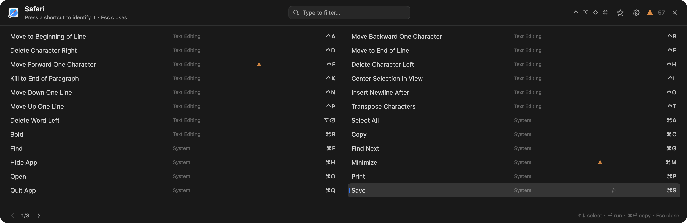
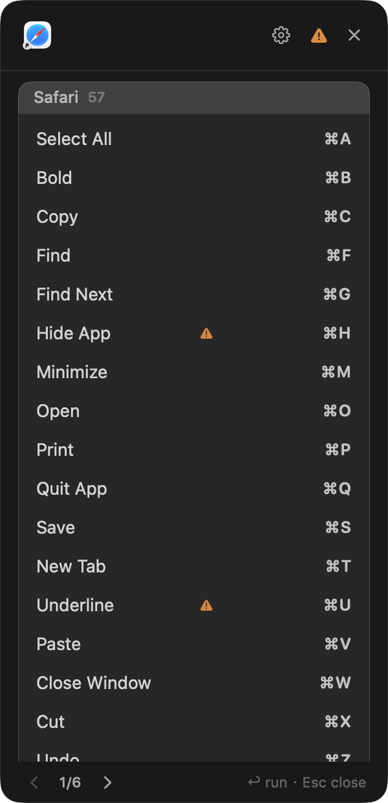
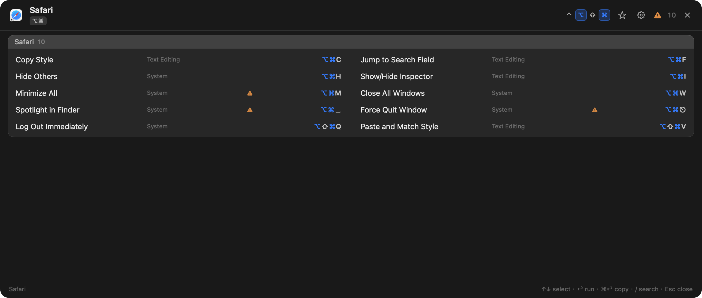
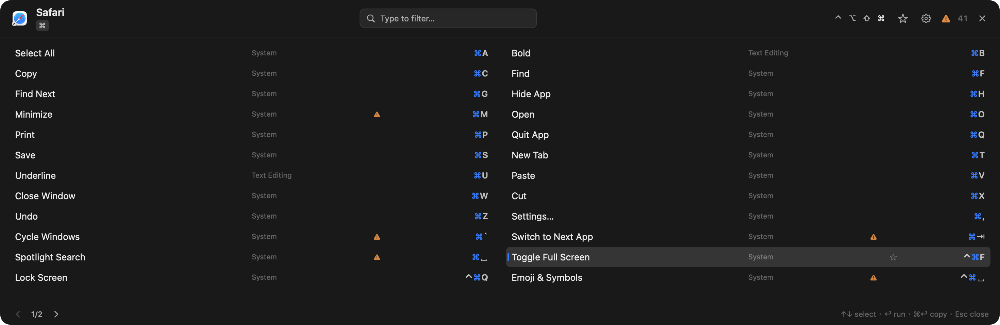
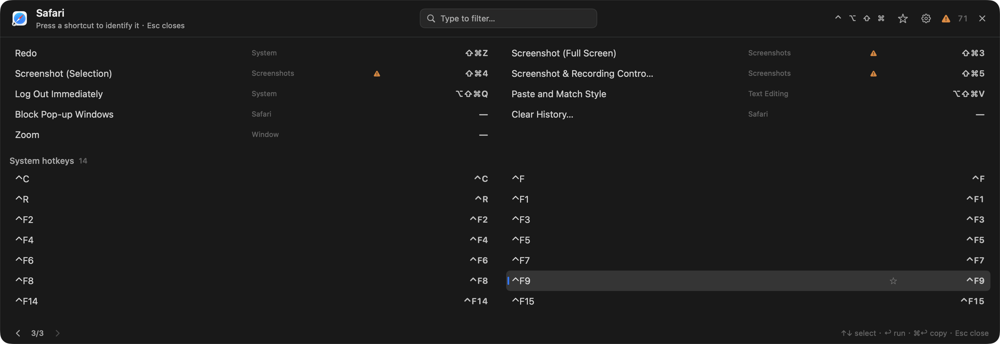
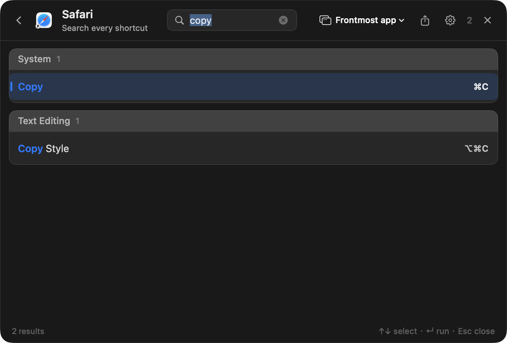
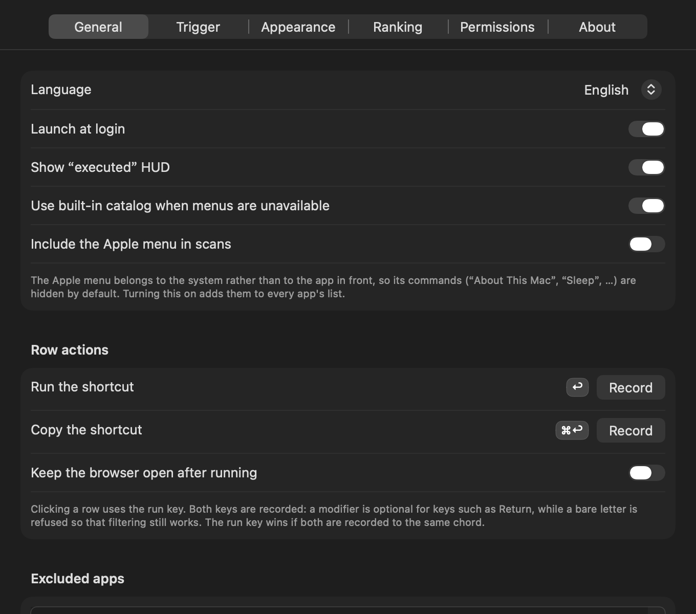
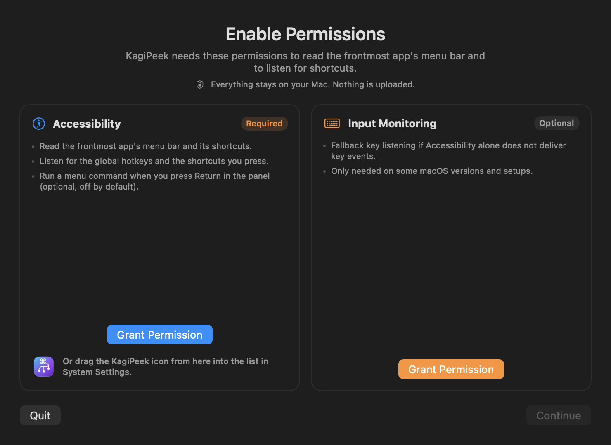

# Kaname

[](https://github.com/suliveevil/Kaname/actions/workflows/ci.yml)
[](https://github.com/suliveevil/Kaname/releases/latest)

**Press and hold a modifier. See what the app you are in can do next.**

Kaname is a menu bar utility for macOS. It reads the frontmost app's menu bar through the Accessibility API and shows its shortcuts in a floating panel. The panel is **persistent**: it stays until you press Esc, toggle it off, or complete a shortcut. A modifier pressed while it is open joins an ordered filter, and a letter pressed while that modifier is still down narrows further; the trigger key's own press is not a filter token, so the panel opens on the full list of complete combinations (⌘C). There is no per-app shortcut pack to install and no configuration file to maintain: if an app has a menu bar, Kaname can show its shortcuts, including chords, disabled items, and conflicts — and it can trigger any of them, including menu items that have no shortcut at all.

The shortcut engine was rewritten around live menu scanning. It then became actionable: the panel became keyboard-driven and clickable, and conflicts began to include macOS system hotkeys. The panel became persistent, with four placement modes, tokenized and pinyin-aware search, Hyper-key matching, per-app statistics in Application Support, guided permission onboarding, an About tab, and a panel/search switch hotkey. It is now organised into two cards ordered by the shortcut itself; the "look at another app" job moved out of the browser window and into the search palette; Settings split into eight tabs — statistics and conflicts each answer a different question and got a page of their own; a conflict names its **type** and a likely winner instead of a severity; the cross-app scan is cached on disk behind a manual rescan; system hotkeys have real names; and triggering the menu item became the primary goal: every menu item is run by pressing it in the menu itself, so menu items with no shortcut at all are reachable too.

`macOS 14.0 Sonoma or later · menu bar agent · local by default · GPL-2.0`

[Features](#features) · [Install](#install) · [First run](#first-run) · [Usage](#usage) · [Configuration](#configuration) · [Privacy](#privacy) · [Architecture](#architecture) · [Development](#development) · [FAQ](#faq) · [中文](#中文)

## Screenshots

<!-- Screenshots are captured by the app's built-in preview mode. -->


*Hold a modifier and pause. The panel covers the focused window by default and narrows to the level of the modifiers you are holding, so each menu item shows what can come next. It stays until you press Esc or toggle it off; ↑/↓ select a menu item and the run key acts on it. Two cards, never interleaved: the app's menu items under its name, then the system's hotkeys under theirs — named where macOS lets us name them (Minimize, Spotlight, Force Quit) and an em dash where it does not. The list is a reference card rather than a copy of the menu bar: menu items are ordered by the shortcut itself and the menu a menu item lives in is the middle column, so ⌘C, ⌘V and ⌘X sit together whichever menu they came from. Each menu item is three aligned columns — the title, its menu, and the shortcut — so a long menu item name never pushes its neighbours' menu paths out of line.*


*The title bar gives way in a fixed order: the result count, then the modifier chips and the favourites toggle, then the app name and subtitle. The settings and close buttons stay reachable — in a one-column panel they used to be pushed outside it. The menu column is dropped rather than squeezed, and the "has a sub-level" chevron moves into the trailing slot so it survives.*


*Pressing a modifier while the panel is open adds it to the panel's ordered filter, and the next press narrows on top of it — ⌃ then F keeps only shortcuts that carry both. Clicking a title-bar chip ticks the modifier instead, so it stays down after release; ⌫ takes back the last token you added, then the last tick.*


*Holding is the other half of the same list: pressing a modifier while the panel is open adds it to the filter, and letting go leaves that condition in place. The menu item keeps its whole chord either way; the modifier you pressed is lit in place rather than stripped, so a menu item narrowed by ⌘ still reads ⌘C and not just C.*


*Triggering the menu item is the point, so the panel does not stop at menu items that can be typed: one with no key equivalent still gets a row, sorted after every shortcut, with the shortcut column left blank. Running it presses the menu item itself — the only way to reach it — and the same press is tried first for every other menu item, with the chord replayed only as a fallback.*


*The palette names the app it is answering for — icon, name, and an app menu for the frontmost app plus every running regular app — and groups its matches into cards by menu. Return closes the palette and triggers the menu item in the app you scoped to: pressing it in the menu when it has a target, replaying the chord otherwise. The palette has no copy action; the export button writes what you are looking at to Markdown.*


*Settings has eight tabs: General, Trigger, Appearance, Statistics, Conflicts, Permissions, Diagnostics, and About. General holds the two recorded action keys; statistics and conflicts each have a page of their own.*


*One card per permission, with what it is for, whether it is required, and a Grant button that opens the exact System Settings pane.*

## Features

| | |
| --- | --- |
| **Live menu scanning** | Reads the frontmost app's menu bar recursively through Accessibility: menu titles, key equivalents, enabled state, and the position of each item in the tree. Items with no key equivalent are kept too — they are triggered by pressing the menu item, not by typing. Any app with a standard menu bar works without a custom shortcut list. |
| **Fallback catalog** | 100 built-in system, text-editing, Finder, and screenshot shortcuts fill in when an app has no menu bar or a scan cannot run. Can be disabled. |
| **Persistent panel** | The panel stays until you press Esc or toggle it off. The summoning press is a trigger, not a filter token: the hotkey (⌃⌥⌘K), the double tap and the hold all open on the whole list, so every menu item is a complete combination (for example ⌘C). A modifier pressed **while the panel is open** joins an ordered filter, and releasing the keys leaves that condition in place. |
| **Modifier and letter filter** | Hold ⌃ while the panel is open, then press a letter, to combine them into one query (`⌃ f`): the list keeps only menu items that answer both, in the panel's normal order. ⌫ takes back the last token — the letter if the letter came last, otherwise that modifier; pressing the same modifier again removes it wherever it sits in the queue, and a third press adds it back at the tail. Completing a shortcut emphasises its description for about 0.4 s, then the panel closes. |
| **Chords** | Multi-stroke shortcuts such as `⌘K ⌘C` descend one level at a time. ⌫ takes back the filter's last token first, then goes back one stroke; Esc closes the panel, and the next open starts from an empty filter; a breadcrumb shows the current prefix. Pressing a key with no match leaves the panel open. |
| **Menu grouping** | Each menu item keeps the menu it came from as its middle column, with the app's own menu titles in the app's language. A group heading appears only when **Panel order** is **By menu group**; there the card is headed with the app's name, the system section with **System hotkeys**, and each config-tool card with that tool's name. The default chord order is one flat list, so it draws no heading. |
| **Three sections** | The app's menu items come first under its name, macOS's own hotkeys follow under **System hotkeys**, and third-party config tools come last — one card per tool, each folded independently, with its row count still visible. The tool section is **hidden by default**; **Settings → Conflicts → Config files** turns it on, and that switch only affects display (the scan and the conflict list keep running either way). While a filter is in force every tool card opens, so a matching row is never hidden behind a fold. A chord the system owns is thus visible next to the one the app owns. Config-tool rows can be copied and favourited but never run; the six whole-Mac actions (sleep, restart, shut down, lock, log out / force log out, force quit) are marked red and are never run either. |
| **Pagination** | Long lists are paged with `1/3` and clickable ‹ ›. **Max menu items per group** is an upper bound, not a promise: if the current window fits fewer, the panel shows fewer instead of pushing the last menu items under the footer. The panel never grows past the screen. |
| **Actionable panel** | ↑/↓ select a menu item, ←/→ always page, the run key (Space by default) runs the selected menu item, the copy key (Return by default) copies it, and Esc closes. Up to four punctuation pairs can page alongside the arrows under **Settings → General → Menu item actions** — `;`/`'` by default, with `,`/`.`, `[`/`]`, `-`/`=` as further checkboxes; several may be on at once, or none. While no modifier is held these keys are consumed by the panel, so the front app never sees them; a completed shortcut is not consumed, so the app still receives it. Clicking a menu item does what the run key does. Both keys are **recorded** under **Settings → General → Menu item actions**. |
| **Executed HUD** | A 0.75 s toast such as `⌘C Copy ✓` confirms a panel execution or a copy. Can be disabled. |
| **Conflict detection** | Bindings that claim the same combination are marked ⚠︎, and **Settings → Conflicts** lists every member with a **type** rather than a severity: menu-order overlap, a system shortcut shadowing a menu item, a third-party tool shadowing either, system-vs-system, system-vs-tool, tool-vs-tool, and a tool fighting itself. Each finding names the layer and says which one wins — or honestly says "same layer, registration order decides, no file records it". The list filters by type and by **related app**, and only rescans when you ask. |
| **System hotkey conflicts** | Spotlight, Mission Control, and other enabled system shortcuts are read through Carbon and compared with the app's menu shortcuts. Matching chords are marked ⚠︎, and the conflict list names the system source. Because a system shortcut sits below a menu item, the verdict is not "maybe" but **the menu item never fires**. Menu items in the panel's system section are named from a built-in table (⌘Space → Spotlight, ⌥⌘⎋ → Force Quit); a chord the table cannot name uses the chord itself as the row's title, with the shortcut column left empty, rather than repeating the chord twice. |
| **Third-party config sources** | Karabiner-Elements, skhd, Keyboard Maestro, BetterTouchTool, Hammerspoon and Alfred keep their shortcuts in a file rather than a menu, and all of them hook the keyboard *below* an app's menu. Kaname parses those files (read-only) so a conflict list can say "⌘⇧4 will never reach Safari" instead of just "two things want ⌘⇧4". Scanning is on by default, with the list of what was read at the top of **Settings → Conflicts**. Showing those rows in the panel and search is a separate switch there, **off by default** — it is a display choice, not a scan permission. |
| **Combo lookup** | Type a combination into search — `cmd shift 4`, `⌘⇧4`, `opt cmd t` — and Kaname answers who owns it, or that it is free, instead of returning an empty list that reads as "not scanned". |
| **Live shortcut test** | **Test this combo** on any conflict row watches one real keypress: two listen-only event taps detect whether another app swallowed the key, and above that layer the verdict falls back to what came to the front. Each result is tagged **confirmed / informative / inconclusive**, so a guess is never presented as a fact. While it listens, every panel behaviour is suspended, so Kaname can never be the thing that ate the key. |
| **Disabled items** | Menu items that the app reports as disabled (`AXEnabled == false`) are greyed out, end with a `lock.slash`, and can optionally be hidden. Their context menu opens with **This menu item is unavailable right now** instead of pretending an action can run; clicking one shows the same sentence in a HUD at most once per menu item per three seconds. |
| **Usage sorting** | The statistics page is one flat list with the shortcut first; the owning app and the command description are the row's note, so the same chord used by two apps is two rows. **Sort by** offers **Shortcut** (the default, in the panel's keyboard order), **App**, or **Command**, and the choice persists. The panel follows its own **Panel order** setting, and the palette always follows match order; neither follows this setting. |
| **Usage statistics** | Counts and last-used times per `app|shortcut`, with system and built-in menu items shown as *System / built-in*. Stored in `~/Library/Application Support/Kaname/usage.json`, capped at 800 entries, resettable. No raw key events or text. |
| **Search** | A global search palette (default ⌃⌥⌘F), also reachable by pressing `/` in the panel. Results arrive in cards by menu, with a banner when the query spells out a combination. Space-separated terms in any order, `+` as a separator, modifier aliases (com/cmd/cm/⌘, op/alt/⌥, …), full pinyin and pinyin initials for Chinese titles, and word initials for English titles; all terms must match. Return closes the palette and **triggers** the selected menu item in the app you scoped to — pressing the menu item when there is one, replaying the chord otherwise. The palette has no copy action; the panel does. |
| **Multi-app scope** | The palette's app menu lists the frontmost app and every running regular app, and its header shows the scoped app's icon and name, so the list always says whose shortcuts these are. Choosing another app re-scans and re-ranks for it, and running a menu item activates that app first. The panel still follows the real frontmost app. |
| **Export Markdown** | The palette's export button saves the current matches (or the scoped app's whole sheet when the field is empty) through a save panel: grouped by menu, `Shortcut` / `Action` columns, unavailable items marked. |
| **Excluded apps and ignored menu items** | An app can be excluded from scanning altogether (a list you fill from a file picker, not a text field of bundle identifiers), and a menu item title can be ignored either globally or for one app — so "Reload Page" in Safari can be hidden without hiding Xcode's. |
| **Panel placement** | Cover the front window (default), a fixed width/height, the whole visible screen, or beside the front window (the older behavior, which also avoids the focused control). |
| **Appearance and accessibility** | The panel follows the system appearance, with Light and Dark overrides. A light panel is a `.popover`-style paper surface and a dark one a `.hudWindow` glass surface, with a 12 pt corner radius and a 16 pt outer margin; Reduce Transparency keeps the solid colour, and Increase Contrast strengthens borders and text. |
| **English and 简体中文** | The interface follows the system language and can be overridden in Settings. |
| **Permission onboarding** | Accessibility is required (menu reading and the global key tap). Input Monitoring is offered as a fallback when a system does not deliver key events with Accessibility alone. **Request** opens the matching System Settings pane — Accessibility does not raise a system prompt, because a prompt would pre-register the app without enabling it; Input Monitoring raises the prompt and opens its pane. A draggable Kaname icon can be dropped into the permission list. Each grant is detected and explained separately; the panel hides while secure input is active. |
| **Hyper-key ready** | Hotkeys with three or more modifiers also match when the event carries extra modifiers, so a Karabiner-style Hyper (⌃⌥⇧⌘) triggers a recorded ⌃⌥⌘ hotkey. Hotkeys with fewer than three modifiers stay strict. |
| **Panel/search switch** | One hotkey (default ⌃⌥⌘S, recorded in Settings) moves between the two surfaces: search visible → panel, panel visible → search, neither → panel. Only one is ever on screen. |
| **Eight settings tabs** | General, Trigger, Appearance, Statistics, Conflicts, Permissions, Diagnostics, and About. Diagnostics turns logging on or off, offers a verbose mode, shows the log folder, and carries both exports — **Export diagnostics archive…** (a zip of the logs) and **Export diagnostics report…** (a JSON report); About shows the icon, version and commit, system version, the manual update check, the data folder, the repository and license. |
| **Private by design** | All shortcut processing is local; settings and statistics are plain JSON files in Application Support, and the only network request is the update check you trigger yourself. No account, no telemetry, no keystroke log. Running a menu item presses it through Accessibility; the one chord is injected only when that press is not available. |

## Install

### Requirements

- macOS 14.0 Sonoma or later.
- Accessibility permission (required). Input Monitoring is an optional fallback if key events are not delivered on your system. Both are explained on first launch.
- The app is a menu bar agent: no Dock icon, and no window when it launches — the menu bar icon is the way in (Settings → General → **Show a Dock icon as well** adds one back).

### Download a release

1. Download the latest DMG from [Releases](https://github.com/suliveevil/Kaname/releases/latest) and verify it against the published `.sha256` file (`shasum -a 256 Kaname-*.dmg`).
2. Open the DMG and drag **Kaname** into **Applications** — launch it from there, not from inside the DMG.
3. Launch Kaname and grant Accessibility as described below. Add Input Monitoring only if the panel does not appear.

Notarized builds open normally. A build that is not notarized is blocked on first launch with an "unverified developer" notice — the app is still fully signed, only Apple's check is missing. After the block dialog, use either:

- **No Terminal:** open **System Settings → Privacy & Security**, scroll down to the Kaname notice, and click **Open Anyway** (the right-click → Open shortcut does not exist on macOS 15), or
- **Terminal:** `xattr -dr com.apple.quarantine /Applications/Kaname.app`

> **Upgrading or replacing an existing copy?** macOS ties privacy grants to the app's code signature. If you replace Kaname with a build signed differently — a local or ad-hoc rebuild, or an install over a release signed by another identity — the old Accessibility grant is no longer valid: open **System Settings → Privacy & Security → Accessibility**, remove the stale Kaname entry if present, and enable the new app again. Without this step no panel will appear. A normal signed update keeps the bundle identifier and its grant.

### Homebrew

Homebrew support is provided as a cask template in [`Distribution/kaname.rb`](Distribution/kaname.rb). The cask is **not published to a tap yet**; until it is, use the DMG or build from source. Once the tap exists:

```bash
brew tap suliveevil/tap
brew install --cask kaname
```

### Build from source

```bash
git clone https://github.com/suliveevil/Kaname.git
cd Kaname
open Kaname.xcodeproj
```

Select the **Kaname** scheme and run. Xcode handles signing for local development. To build and package a DMG without opening Xcode:

```bash
./scripts/build_release.sh
# produces build/Kaname-<version>.dmg
```

To build and replace `/Applications/Kaname.app` in one step:

```bash
./scripts/install.sh
```

The release script signs with a Developer ID Application identity when one is available and attempts notarization; otherwise it falls back to ad-hoc signing. Ad-hoc builds work locally but are not notarized, and macOS may require you to re-grant permissions after replacing the app.

## First run

1. Launch Kaname. Nothing opens on screen — the app appears in the menu bar. If Accessibility is missing, the menu bar menu carries a **Permission guide** item instead. **Settings → Permissions** lists both grants and their current status.
2. Open **Settings → Permissions** and click **Request** next to Accessibility. Kaname opens the matching **System Settings → Privacy & Security → Accessibility** pane; enable Kaname there. Accessibility does not raise a system prompt of its own: a prompt would register the app without enabling it, so the app is added by dragging the Kaname icon from the Permissions tab into the list, or with **+**.
3. Try holding ⌘. The first launch shows one HUD — **Hold ⌘ or double-tap it to open the panel** — and never repeats. If the panel appears, nothing else is needed.
4. If no panel appears, quit Kaname, click **Request** next to **Input Monitoring** (it raises the system prompt and opens that pane too), enable Kaname, and reopen the app. This is the fallback for systems that do not deliver key events with Accessibility alone.
5. Check **Settings → Permissions** to confirm the current state.

The full walkthrough, including reset commands and signature-related re-granting, is in [docs/PERMISSIONS.md](docs/PERMISSIONS.md).

## Usage

### Trigger

| Trigger | How |
| --- | --- |
| Hold the trigger key | Hold the trigger key without pressing another key for 0.5 s (0.3–0.9 s in 0.1 s steps) | Default gesture. The trigger key is one of **Any modifier**, **Left Control**, **Left Option**, **Left Command**, **Right Command** (default), or **Right Option**; combinations are not supported. The summoning press is not a filter token, so the panel opens on the whole list; a modifier pressed while it is open narrows. Shift alone is ignored. |
| Press the trigger key twice | Two complete presses inside 0.3 s (0.15–0.8 s) | Alternative gesture. Any key press between the two presses cancels it. |
| Panel hotkey | ⌃⌥⌘K by default | One of the three global hotkeys. The panel stays open until Esc or the hotkey again. Switching the frontmost app (or the desktop) closes the panel; summon it again to see the new app's shortcuts. |
| Search | ⌃⌥⌘F by default | Opens the search panel independently. The hotkey is configurable. |
| Switch panel/search | ⌃⌥⌘S by default | Search visible → panel; panel visible → search; neither → panel. Only one is ever on screen. Recordable in Settings. |
| Two independent switches | Settings → Trigger | The modifier gesture and the three hotkeys each have their own switch at the left of the card header. They can both be live, only one can, or both can be off — both off means no trigger fires, while the menu bar and settings keep working. |

### The panel

- **One level at a time.** With no filter and an empty prefix every menu item is a complete combination (for example ⌘C). A modifier pressed while the panel is open joins the ordered filter, so the list narrows as more tokens arrive; a chord prefix shows each menu item's next key.
- **The panel is persistent.** It stays on screen until you press Esc or press the panel hotkey (or the switch hotkey) again. Releasing the modifiers leaves the filter in place rather than widening the list, there is no idle timer, and the old auto-hide delay is gone.
- **Filter with modifiers and letters.** A modifier pressed while the panel is open is added to an ordered filter; hold ⌃ and press a letter to make the query `⌃ f`. ⌫ takes back the last token — the letter if it came last, otherwise that modifier — and once the queue is empty the key goes back to chord backtracking. Pressing the same modifier again removes it wherever it sits in the queue; a third press adds it back at the tail. Releasing the keys does not clear anything, and Esc closes the panel; the next open starts from an empty filter.
- **Fullscreen and Space changes keep the panel usable.** On a full-screen space or with the menu bar hidden, the panel stays fully on screen and clear of the top safe area (the menu bar or the notch); switching Space refreshes the front app's menu instead of leaving a stale list.
- **Selection and highlight are different things.** Highlight follows your fingers (the menu items the current prefix can reach); selection is your cursor, moved with ↑/↓ or the pointer. The selected menu item carries a 3 pt accent bar on its leading edge and a slightly brighter title, so it is visible on the light palette and to VoiceOver (which announces it as selected). Neither state moves the row text.
- **The shortcut still reaches the app.** Kaname only observes keys; it does not remap them. Completing a shortcut closes the panel and lets the same key event continue to the front app, so the menu item runs immediately, exactly as if the panel had not been open.
- **Chords stay open.** If a stroke is the first step of a multi-stroke shortcut, the panel descends one level and shows what can follow; a breadcrumb shows the prefix. ⌫ takes back the filter's last token first, then goes back one stroke, and only while no other modifier is held, so ⌘⌫ stays an ordinary shortcut. Esc closes the panel whatever the modifiers are — ⌥⌘Esc included, which therefore never reaches the front app — and the next open starts from an empty filter.
- **Keyboard and mouse.** ↑/↓ select, ←/→ always page, the run key acts on the selection, Esc closes. Any punctuation pairs ticked under **Settings → General → Menu item actions** page too; the default pair is `;` / `'`, and `,` / `.`, `[` / `]`, `-` / `=` can be added. The keys are judged by the character they type, and `+` (Shift+=) is never a paging key, so it stays available to the Shift-hint layer's `0–9` / `a–z` labels and never conflicts. With no modifier held these keys are consumed by the panel and never reach the front app; clicking a menu item does the same as the run key.
- **`/` opens the search palette.** The panel has no text field of its own: `/` swaps it for the search palette with the cursor already in the field, and every open starts with an empty query, so nothing from last time is carried over. Press `/` again while the field is empty to go back to the panel (there is nothing to lose); once you have typed a query, `/` is an ordinary character and the back chevron in the title bar takes you back. ⌘/ is never taken; it belongs to the front app.
- **Run or copy.** The run key (Space by default) closes the panel and triggers that menu item in the front app: it presses the menu item itself when the scan kept one — which is also the only way to run a menu item that has no shortcut at all — and replays the chord into the app as a fallback. The copy key (Return by default) writes the chord to the clipboard and leaves the panel open (a menu item with no shortcut copies its menu path instead). Both are **recorded** under **Settings → General → Menu item actions**; the footer always spells out the two keys you actually chose. A menu item with further steps descends a level instead of running, and a disabled menu item is ignored.
- **Shift reveals targets.** While Shift is held, the first 36 menu items show `0–9` / `a–z` labels; Shift plus that character runs that menu item directly. The label layer exists only in the panel — inside search, Shift still belongs to the text field.
- **Completing a shortcut.** The menu item is highlighted for about 0.4 s, the panel closes, and the shortcut runs in the app. A key with no match leaves the panel open instead of closing it.
- **Three sections, and paging.** The app's menu items come first, ordered by the shortcut (shorter chords first, then ⌘ → ⌥ → ⌃ → ⇧, then the key) or, when **Panel order** is set to **By menu group**, by top-level menu; the system's hotkeys follow under **System hotkeys**, and config tools come last as one card per tool — hidden by default, and when shown folded independently with their row counts still visible; a filter in force opens every card. The menu a menu item lives in is the middle column, not a heading. Long lists show `1/3` with clickable ‹ ›.
- **Empty panels say why.** An empty list is one of four states with a fixed priority: missing Accessibility permission (with a **Permission guide** button), still scanning (with a spinner), favourites-only with nothing pinned, or no match for the current filters. The permission case wins over scanning, because no scan can finish without it.
- **When nothing can be shown, the reason is stated.** A menu item the app reports as disabled ends with a `lock.slash`; right-clicking it shows **This menu item is unavailable right now**, and clicking it says the same thing in a HUD once per menu item per three seconds, so repeated clicks cannot stack identical notices.
- **Changing Panel order announces itself.** Switching between **By modifier** and **By menu group** while the panel is visible shows one HUD line with the new order; the panel itself carries no permanent mode label. The new order is also applied immediately.
- **Conflicts and disabled items.** Conflicting menu items carry ⚠︎. Disabled menu items are greyed out unless you choose to hide them.
- **Long descriptions** are truncated with an ellipsis according to the display setting.

### Search

Press ⌃⌥⌘F, or press `/` while the panel is open. Search covers the scoped app's menu shortcuts and the built-in catalog; with no scope chosen it also covers the system hotkeys and the config-tool rows. The palette's app menu switches scope.

- **Terms are unordered and all must match.** `com op x`, `op cm x`, and `cmd+opt+x` all find ⌘⌥X; `+` is just another separator.
- **Modifier aliases** are understood: `com`/`cmd`/`command`/`cm`/`⌘`, `op`/`opt`/`option`/`alt`/`⌥`, `ct`/`ctl`/`ctrl`/`control`/`⌃`, `sh`/`sft`/`shift`/`⇧`.
- **Chinese titles match pinyin:** full pinyin (`jian qie`), spaced syllables, and initials (`jq` for 剪切). **English titles match word initials:** `fs` finds Find Similar. Better matches rank first, regardless of the order you type the terms in.
- ↑/↓ moves the selection.
- **Return runs the selected menu item.** The palette closes, the app you scoped the search to is activated, and the menu item is triggered there: it is pressed in the menu when the scan kept one, otherwise that one chord is replayed into the app.
- **The palette has no copy action.** To copy a chord without running it, use the copy key in the panel (Return by default); Space runs.
- **Panel and search are mutually exclusive.** Opening one closes the other. The switch hotkey (⌃⌥⌘S by default) moves from search to panel, from panel to search, or opens the panel when neither is visible.
- Search queries are not recorded.

### Menu bar and settings

Kaname is an `LSUIElement` agent: no Dock icon, and no window at launch. The menu bar icon is the whole interface — **Search Shortcuts…**, **Shortcut Panel**, **Settings…**, and **Quit Kaname**. Those four are the whole menu; the **Permission guide** only appears while Accessibility is still missing and disappears once it is granted. There is no pause item: turning both trigger switches off in Settings is the pause. Its own menu bar (the app menu inside its windows) carries ⌘, for Settings and ⇧⌘F for the search palette.

Settings is one utility window: it can be closed and resized but not minimised, and reopening it always brings the same window forward. When Settings is visible, **Permission guide** appears as a sheet attached to it, so the guide cannot hide behind the window or in another Space; before Settings has ever been opened, the guide stands alone.

Settings has eight tabs:

| Tab | What it covers |
| --- | --- |
| General | Interface language, launch at login, executed HUD, **Show a Dock icon as well**, **menu item actions** (the two recorded action keys), **excluded apps** (added from a file picker, removed from the list), and **ignored menu items** (one collapsible group per scope: global rules, then one per app, plus the built-in catalog and **Include the Apple menu in scans** switches). |
| Trigger | Two independent switches, each at the left of its card header: **Modifier gesture** (hold still / press twice, the trigger key, and the matching delay) and **Global hotkeys** (the panel, search, and switch hotkeys). Both can be live, only one can, or both can be off — both off is the pause state. |
| Appearance | Key style, panel theme, key position, **panel order** (by modifier, or by menu group), columns, **max menu items per group** and description length (typed; Return or leaving the field commits, an out-of-range entry keeps the previous value), disabled items, **panel placement** (cover the front window, fixed size with width and height, fill the screen, or beside the front window), and a **Favorites** card for pinning and filter behaviour. |
| Statistics | **Sort by** (shortcut, app, or command description), one flat list of shortcuts with the owning app and description as a note, **Show data folder**, **Reset statistics**, and **Restore all settings…**. |
| Conflicts | Third-party **config file sources** first (which files were read, how many bindings each contributed, a rescan), then the conflict list with a **type** filter, a **related app** filter, the scan timestamp, a manual rescan, and a **Test this combo** action on each row. |
| Permissions | Accessibility and Input Monitoring status, **Request** (opens the matching System Settings pane; Input Monitoring also raises the system prompt), and the draggable Kaname icon. |
| Diagnostics | Logging on/off, verbose logging, the log folder, **Export diagnostics archive…**, and **Export diagnostics report…**. |
| About | Icon, version and commit, system version, **Check for updates**, data folder, repository and license. |

The search palette is the surface you get from the search hotkey or by pressing `/` in the panel. Its header names the app it is answering for and offers an app menu with the frontmost app and every running regular app, so any of them can be searched; **Export Markdown** writes what you are looking at to a file. Its list is live: hover to select, click or press Return to run the menu item in that app, Esc to close. The update check is manual: it compares the latest GitHub release and never downloads or installs anything.

## Configuration

| Setting | Values | Default |
| --- | --- | --- |
| Modifier gesture | On / Off (its own checkbox) | On |
| Trigger gesture | Hold still / Press twice | Hold still |
| Trigger key | Any modifier / Left Control / Left Option / Left Command / Right Command / Right Option | Right Command |
| Hold delay | 0.3–0.9 s, 0.1 s steps | 0.5 s |
| Double-tap detection | Follows the system double-click speed, clamped to 0.25–0.6 s | Automatic |
| Global hotkeys | On / Off (their own checkbox) | On |
| Panel hotkey | Any key combination | ⌃⌥⌘K |
| Search hotkey | Any key combination | ⌃⌥⌘F |
| Switch panel/search hotkey | Any key combination | ⌃⌥⌘S |
| Panel placement | Cover the front window / Fixed size / Fill the screen / Beside the front window | Cover the front window |
| Fixed panel width | 320–4000 pt | 720 |
| Fixed panel height | 240–3000 pt | 620 |
| Show a “shortcut triggered” confirmation | On / Off | On |
| Sort by (statistics) | Shortcut / App / Command description | Shortcut |
| Built-in catalog when menus are unavailable | On / Off | On |
| Include the Apple menu in scans | On / Off | Off |
| Show a Dock icon as well | On / Off | Off |
| Show unavailable menu items | On / Off | On (greyed out) |
| Key style | Symbols / Words | Symbols |
| Columns | 1–3 | 2 |
| Max rows per page (upper bound; the panel fits fewer when the window is short) | 6–60 | 24 |
| Max description length | 8–80 characters | 30 |
| Language | System / English / 简体中文 | System |
| Run a menu item | Any recorded key | Space |
| Copy a menu item | Any recorded key | Return |
| Key position | Left / Right | Right |
| Panel theme | System / Light / Dark | System |
| Pin favourites to the top | On / Off | On |
| Filters can hide favourites | On / Off | Off |
| Ignored menu items | A title, global or bound to one app | None |
| Launch at login | On / Off | Off |
| Excluded apps | Bundle identifiers, chosen from a file picker | None |
| Scan config files (Conflicts tab) | On / Off | On |
| Diagnostics logging | On / Off | On |
| Verbose diagnostics | On / Off | Off |
| Usage statistics | Per-shortcut counts with the owning app and command, 800-entry cap | Stored in Application Support |

## Privacy

- **Shortcut handling is local.** Kaname has no accounts, no analytics, and no telemetry, and no data about you, your apps, or your shortcuts is sent anywhere. The single exception is the update check you trigger yourself: it fetches the public GitHub release document once and uploads nothing. The source is available under the GPL-2.0.
- **Accessibility is used for menus and the key tap.** Kaname reads menu titles, key equivalents, and enabled state from the frontmost app, and uses a global key tap to see modifier and key state. It does not read documents, text fields, or window contents.
- **Scans stay short-lived, and never leave the machine.** Menu data is cached in memory per app for 20 seconds, and on disk — per app, for up to 10 minutes, in `~/Library/Application Support/Kaname/menu-cache/` — so re-opening the panel for the same app, or relaunching Kaname, skips the AX walk. The disk copy records only what a scan already read (menu titles, paths, key equivalents, enabled state); it is dropped when a scan-shaping setting changes, when it turns 10 minutes old, or when you press "Restore all settings…". There is no live menu observer, and nothing is uploaded.
- **Two files hold user data; the rest is derived.** Settings and statistics are `settings.json` and `usage.json` in `~/Library/Application Support/Kaname/`, written atomically. A file that cannot be decoded is renamed `*.corrupt-<timestamp>.json` and kept rather than silently discarded. Next to them sit `conflicts-cache.json` (the last cross-app conflict scan, so opening the page does not rescan every app), `menu-cache/` (menu scans, valid for 10 minutes) and `logs/` + `crash/` (the diagnostic log, the last 30 action names, the crash reports) — all reproducible, all safe to delete, and the log can be switched off in **Settings → Diagnostics**.
- **Keys are observed, not recorded.** The global key tap computes the current modifier/key state and detects the recorded hotkeys and the panel's own navigation keys. It passes events through to the front app except those keys, which it consumes so the app does not also receive them. Kaname never stores a stream of key presses or typed text.
- **One chord is injected, and only when pressing cannot be used.** When you press the run key, click a row, or press Return in the search palette, Kaname triggers that menu item by pressing it through Accessibility; the row's chord is posted once (`CGEvent`, HID event tap) only when there is no menu item to press or the press is refused. It does not replay what you type, it does not inject anything while you are just browsing the panel, and the copy key never injects at all. This is the one place where the app synthesises input, and it exists so a menu item can be run without reaching for the menu.
- **Statistics are minimal.** Kaname stores a use count and last-used timestamp per `bundleID|chord` (one row per app and shortcut), capped at 800 entries and resettable in Settings. No raw key events or queries are stored.
- **Secure input wins.** When macOS reports secure input (password fields, login windows), the panel hides.
- **Config files are opened read-only, and only for the scan.** When third-party scanning is on, Kaname reads `karabiner.json`, `skhdrc`, Keyboard Maestro's macro library, BetterTouchTool's data store, `init.lua` and Alfred workflow `info.plist` under your home directory to find their shortcuts. It opens them read-only (BetterTouchTool's database with SQLite's read-only flag), never writes, never uploads, and keeps only chord, title and owning tool in memory — no file is copied out and nothing from those files is written to disk. Turning the setting off forgets everything found and opens no such file again. |
- **No telemetry or upload.** No shortcut, app, or usage data is ever sent; the update check only reads a public release document.

See [docs/PRIVACY.md](docs/PRIVACY.md) for the complete list of what is read, written, sent and injected, [docs/PERMISSIONS.md](docs/PERMISSIONS.md) for the grants, and [docs/ARCHITECTURE.md](docs/ARCHITECTURE.md) for the implementation.

## Compared with vim-which-key and emacs which-key

Kaname borrows the interaction model, not the implementation.

| | Kaname | vim-which-key | emacs which-key |
| --- | --- | --- | --- |
| Scope | Any macOS app with a menu bar | Neovim keymaps | Emacs keymaps |
| Data source | Live Accessibility menu scan plus a built-in fallback | Lua configuration | Active keymaps |
| Invocation | Modifier gesture (hold or double-tap), three global hotkeys, or the panel/search switch hotkey | Leader key | Prefix key timeout |
| Navigation | Persistent panel, complete shortcuts, progressive highlight, chord breadcrumb, ⌫ back, Esc close | Prefix menus | Prefix menus |
| Display | Floating panel: over the focused window, beside it, or filling the screen | Popup window | Minibuffer or child frame |
| Ranking | Key or menu-group order in the panel; Shortcut / App / Command order for the statistics page | Configured order | Configured order |
| Configuration | Settings UI, no config file | Lua tables | Emacs variables |
| Platform | macOS 14+ | Neovim | Emacs |

Unlike the editor plugins, Kaname cannot define or remap shortcuts. It reflects what the app already exposes, which is why it works immediately across applications and why it cannot invent a shortcut that is not in a menu.

The editor plugins only display the next keys; Kaname also runs the menu item for you — by pressing the menu item, so one with no shortcut is reachable too.

## Architecture

At a high level:

```
frontmost app → Accessibility menu scan → ShortcutEngine (20 s memory cache,
                                              ├─→ PanelSections  → panel card 1: the app's menu items
                                              │                    (PanelSortOrder: chord / menu-group order)
                                              ├─→ SearchCorpus   → search palette (app scope,
                                              │                    grouped into cards by menu)
                                              └─→ ConflictDetector → Settings → Conflicts
global keys   → key tap → HotkeyMatcher ──────┤
                                              ├─→ UsageStore → Application Support/usage.json
                                              └─→ PanelPlacement → cover / fixed / fill / beside
system hotkeys → Carbon CopySymbolicHotKeys ──┤
                                              ├─→ SystemHotkeyNames → panel card 2 + conflicts
                                              └─→ MenuScanCache    → menu-cache/ (10 min)
```

The shortcut engine, chord resolution and ordering, formatting, description cleanup, conflict detection and caching policy, search corpus (tokenizer and pinyin), hotkey matching, panel placement, usage statistics, Markdown export, and semantic versions live in a pure SwiftPM target (`KanameCore`) with XCTest coverage. AppKit, Accessibility, and SwiftUI code sit above it: `SystemHotkeyReader` (Carbon system shortcuts, plus the `SystemHotkeyNames` table that gives them names), `AppDirectory` (running-app list for the search scope and the conflict scan), `ConflictCache` (the cross-app scan kept between launches), `MenuScanCache` (menu scans on disk), and `UpdateChecker` (the manual update check). The full component map, threading model, cache invalidation, and known limitations are in [docs/ARCHITECTURE.md](docs/ARCHITECTURE.md).

## Development

Run the pure-logic tests:

```bash
swift test
```

If `swift test` fails because `xcode-select` points at the Command Line Tools, prefix it with `DEVELOPER_DIR=/Applications/Xcode.app/Contents/Developer`, or select Xcode with `sudo xcode-select -s /Applications/Xcode.app/Contents/Developer`.

Build the app the same way CI does:

```bash
xcodebuild \
  -project Kaname.xcodeproj \
  -scheme Kaname \
  -configuration Debug \
  -derivedDataPath build/DerivedData \
  CODE_SIGNING_ALLOWED=NO \
  build
```

CI runs the same job twice, on `macos-15` and `macos-26`: checkout, a Debug build and a Release build with signing disabled, then `swift test`, a DMG packaging check on the older runner, and a coverage report for the pure target. Coverage is a gate, not a warning: a run whose `Core/Pure` line coverage is below 70% fails. It runs on every branch push and on pull requests. See [`.github/workflows/ci.yml`](.github/workflows/ci.yml).

If `sandbox-exec` is unavailable in your environment (the build system wraps every compile in it, and nested sandboxing can be denied), both `xcodebuild` and `swift test` fail with `sandbox_apply: Operation not permitted`. Workarounds: `swift test --disable-sandbox`, and `./scripts/build_swiftc.sh Release`, which compiles the same sources with `swiftc` and loads the SwiftUI macros explicitly. `scripts/install.sh` falls back to it automatically when `xcodebuild` cannot build.

Release:

```bash
./scripts/build_release.sh   # build/Kaname-<version>.dmg
```

Contributor setup, layering rules, the "a setting change touches six places" checklist, and the test policy are in [docs/CONTRIBUTING.md](docs/CONTRIBUTING.md); the release steps are in [docs/RELEASING.md](docs/RELEASING.md). What shipped, and what to check when upgrading, is in [docs/RELEASES.md](docs/RELEASES.md). When something does not work, start with [docs/TROUBLESHOOTING.md](docs/TROUBLESHOOTING.md).

For the git workflow with parallel agents — one worktree and one branch per agent, a single integrator on `main` — [AGENTS.md](AGENTS.md) is the rule; [docs/CONTRIBUTING.md](docs/CONTRIBUTING.md) explains the reasoning.

The Homebrew cask template is [`Distribution/kaname.rb`](Distribution/kaname.rb). It must be copied into a tap before `brew install --cask kaname` works.

`build_release.sh` also accepts `KANAME_SIGN_IDENTITY` (choose a signing identity), `KANAME_NOTARY_PROFILE` (a `notarytool` keychain profile to notarize with), and `KANAME_SKIP_DMG=1` (build the app only).

## FAQ

**Nothing happens when I hold a modifier.**
Check the trigger mode, whether Accessibility is granted, and whether you are in a secure input field. If the panel still does not appear, grant Input Monitoring and relaunch. If the app has no menu bar, enable the built-in catalog. Full checklist in [docs/FAQ.md](docs/FAQ.md#nothing-happens-when-i-hold-a-modifier).

**Why does app X show no shortcuts?**
Kaname can only show shortcuts the app exposes in its menu bar. Shortcuts implemented in custom views, web content, or games are invisible; menu items without key equivalents are not guessed. See [docs/FAQ.md](docs/FAQ.md#why-does-app-x-show-no-shortcuts).

**Does it upload anything or record what I type?**
No. Shortcut handling is local, the key tap only passes events through (except Kaname's own hotkeys and the panel's navigation keys; a completed shortcut still reaches the app), and statistics contain only counts and timestamps grouped by app. Settings and statistics are two JSON files in Application Support. The one thing it does synthesise is a single chord, and only as a fallback: pressing the run key or clicking a menu item presses the menu item through Accessibility, and that menu item's shortcut is posted into the front app once only when the press is not available. The only network request is the update check you press yourself. See [Privacy](#privacy).

**Why doesn't the panel close by itself?**
The auto-hide delay was removed. The panel is persistent and closes when you press Esc or toggle it off with the panel/switch hotkey. Switching apps or desktops closes it too, because its contents belong to the app it was opened over. Releasing modifiers does not clear the filter; it stays until you take it back, and the next open after a close starts from an empty filter.

**Where is my data, and will reinstalling lose it?**
In `~/Library/Application Support/Kaname/` as `settings.json` and `usage.json`. They are independent of the app bundle and the preference domain, so reinstalling or updating keeps them; only deleting the folder removes them. See [Privacy](#privacy) and [docs/FAQ.md](docs/FAQ.md).

**Can I use a Hyper key?**
Yes. Record a three-modifier hotkey in **Settings → Trigger**; a Karabiner-style Hyper (⌃⌥⇧⌘) event carries a superset of modifiers and still matches. Hotkeys with fewer than three modifiers are matched strictly.

**Why isn't it on the Mac App Store?**
Reading another app's menu bar and observing global keys are not possible inside the App Sandbox. Kaname ships outside the store with the sandbox disabled.

**What does ⚠︎ mean?**
Another binding — an app menu item, an enabled macOS system shortcut, or a third-party tool's config — uses the same key combination. macOS decides which one wins; Kaname only reports the conflict, names its type and the layer. Details are in **Settings → Conflicts**.

**Do I need to grant permissions again after updating?**
The upgrade that changed the bundle identifier **always** required re-granting Accessibility. Builds since then keep the same identifier, so a signed update normally keeps its grant; ad-hoc local builds may still be treated as new after every rebuild. See [docs/FAQ.md](docs/FAQ.md#do-i-need-to-grant-permissions-again-after-an-update).

## License

GPL-2.0. See [LICENSE](LICENSE).

## Credits

Kaname is built on the ideas and code of [KagiPeek](https://github.com/Voltline/KagiPeek), refactored into an independent project and maintained by [suliveevil](https://github.com/suliveevil). The shortcut engine was rewritten, then made actionable, and the panel became persistent; the interaction model is inspired by [vim-which-key](https://github.com/folke/which-key.nvim) and [emacs which-key](https://github.com/justbur/emacs-which-key).

The conflict-checking work — naming the type of a clash, the event-stack layer model, third-party config scanning, the combo lookup and the live keypress test — takes its ideas from [HotkeyClash](https://github.com/Wunderlandmedia/HotkeyClash) by Wunderlandmedia, also GPL-2.0. The layer ranking and the head/tail event-tap technique are theirs; the code here is written for Kaname's own models.

Five ideas come from [Menu-Bar-Search](https://github.com/BenziAhamed/Menu-Bar-Search): addressing a menu item by its position in the menu tree (`pathIndices` → `axPath`), weighting search hits by how close a matched menu level is to the menu item itself, caching scans on disk behind a control file that records the settings they were written under, resolving the app that owns the menu bar rather than merely the frontmost one, and reporting *why* a scan came back empty instead of showing an empty list. The `showAppleMenu` setting is its toggle, defaults off.
---

## 中文

[English](#kaname) · [中文](#中文)

**按住修饰键，看看当前 App 接下来能做什么。**

Kaname 是一个 macOS 菜单栏工具。它通过辅助功能（Accessibility）API 读取前台 App 的菜单栏，用浮层面板显示它的快捷键。面板是**持久**的：它会一直保持到你按 Esc、再次切换关闭或完成一条快捷键。面板打开后按下的修饰键会加入有序筛选队列，再按字母即可组合筛选（如 ⌃ + F 得到 `⌃ f`）；触发键那一次按下只是唤出，不入队，所以热键、连按与按住都从完整列表开始，每个菜单项显示完整组合键（如 ⌘C）。不需要为每个 App 安装快捷键包，也不需要维护配置文件：只要 App 有菜单栏，Kaname 就能显示它的快捷键，包括多段组合键、不可用项和冲突。

快捷键引擎被重写：实时菜单扫描取代静态列表，面板新增多段组合键导航与搜索。这套引擎随后变得真正可用：面板可以用键盘驱动、也能点击执行，冲突检测纳入系统热键。面板变为持久面板，并新增四种面板位置、分词与拼音搜索、Hyper 键匹配、按 App 统计的 Application Support 存储、授权引导、独立的“关于”标签页，以及切换面板/搜索的热键。面板如今整理为两张卡片、菜单项按快捷键本身排序；把“看另一个 App”的职责从速查窗口搬进搜索面板（用 App 范围切换）；把设置拆成八个标签页（统计与冲突各回答一个问题，各自独立成页）；冲突不再只报严重度，而是给出**类型**和可能的胜负；跨 App 扫描结果落盘、只在需要时手动重扫；系统热键也有了真正的名字；同时把“执行菜单项”变成首要目标——菜单项一律按自身执行，因此没有快捷键的菜单项同样可以触发。

> 系统要求：macOS 14.0 Sonoma 或更高版本。仅支持 macOS，不提供 Windows 或 Linux 版本。

界面截图见上。

### 功能

| | |
| --- | --- |
| **实时菜单扫描** | 通过辅助功能递归读取前台 App 的菜单栏：菜单标题、快捷键与启用状态。任何标准菜单栏 App 装完即用，无需手工维护列表。 |
| **内置兜底目录** | 100 条系统、文本编辑、Finder 与截图快捷键，在 App 没有菜单栏或扫描失败时使用。可在设置中关闭。 |
| **持久面板** | 面板一直保持到按 Esc 或再次切换关闭。触发键那一次按下只是唤出，不是筛选 token；热键（⌃⌥⌘K）、连按与按住都从完整列表开始，每个菜单项是完整组合键（如 ⌘C）。面板打开后按下的修饰键会加入有序筛选队列，松开按键不会清除条件。 |
| **修饰键 + 字母筛选** | 面板打开后按住 ⌃，再按字母即可把两者组合成一个查询（`⌃ f`），列表只留下同时满足两项的菜单项，顺序不变。⌫ 依次撤销：末尾是字母就删字母，末尾是修饰键就移除该修饰键；再按同一修饰键会从队列任意位置移除它，第三次按下又作为新队尾加入。完成一条快捷键时该菜单项说明以强调色显示约 0.4 秒，然后面板关闭。 |
| **多段组合键** | 支持 `⌘K ⌘C` 这类 chord：按下 ⌘K 后若还有后续组合，面板留在原位并进入下一层。⌫ 先撤销筛选队列末尾的 token，再返回上一层；Esc 关闭面板，下次打开从空筛选开始；顶部面包屑显示当前前缀；没有匹配的按键时面板保持打开。 |
| **菜单分组** | 每个菜单项把所属菜单作为中间一列保留，菜单名来自 App 自己的菜单结构与语言。只有**面板排序**为**按菜单栏分组**时才画分组标题，标题是 App 名（系统分区是**系统热键**，配置工具卡是工具名）；默认的按修饰键排序是一张平铺列表，不画标题。 |
| **三个分区** | App 自己的菜单项在前，标题是 App 名；macOS 的系统热键其次，标题是**系统热键**；第三方配置工具最后，一个工具一张卡，各自独立折叠但仍显示条数，点某张卡的标题只展开那一张。工具区**默认不显示**，在 **设置 → 冲突 → 配置文件** 里打开；这个开关只影响显示，扫描与冲突列表照旧工作。有筛选条件时所有工具卡自动展开，匹配行不会被折叠挡住。系统占用的组合键因此能和 App 占用的并排比较。配置工具行可以复制、可以收藏，但**不执行**；六个会动整台 Mac 的动作（睡眠、重启、关机、锁屏、退出登录 / 立即注销、强制退出）用红色标题标注，**永不执行**，只允许复制。 |
| **自动分页** | 菜单项过多时显示 `1/3` 与可点击的 ‹ ›，面板不会撑破屏幕。**每个分组最多显示**是上限而不是承诺：当前窗口放不下时只显示放得下的数量，不会把最后几条挤到页脚下面。 |
| **可操作面板** | ↑/↓ 选择菜单项、←/→ 翻页、执行键（默认 Space）执行选中项——有菜单项就按菜单项，否则回放该组合键——复制键（默认 Return）只复制到剪贴板、Esc 关闭。没有按住其他修饰键时这些键由面板消费，不会传到前台 App，而完整快捷键不会被吞掉。点击某个菜单项等同于执行键。执行键和复制键都可以在 **设置 → 通用 → 菜单项操作** 里录制。 |
| **已执行提示** | 面板里执行或复制一条快捷键后，按设置显示 0.75 秒的轻提示，例如 `⌘C 复制 ✓`。可关闭。 |
| **冲突检测** | 同一组合键被多条绑定占用时显示 ⚠︎，**设置 → 冲突** 列出全部成员，并且按**类型**而不是严重度分类：菜单项顺序重叠、系统快捷键压住菜单项、第三方工具压住菜单项或系统键、系统对系统、系统对工具、工具对工具，以及工具自己和自己打架。每条结论都标明所在层并给出胜负——或者诚实说明“同一层，注册顺序决定，而配置文件不记录它”。列表可以按类型和**相关 App** 筛选，且只在你要求时重扫。 |
| **系统热键冲突** | 通过 Carbon 读取已启用的系统快捷键（聚焦搜索、调度中心、截图……），与当前 App 的菜单快捷键比对；相同组合键标 ⚠︎，冲突列表标明系统来源。由于系统快捷键位于菜单项之下，结论不是“可能”，而是**该菜单项永远不会触发**。内置名字表能认出的按名字显示（⌘Space → 聚焦搜索）；表里认不出的把组合键本身当作标题、快捷键列留空，不再显示 **—**，也不重复两遍。 |
| **第三方配置来源** | Karabiner-Elements、skhd、Keyboard Maestro、BetterTouchTool、Hammerspoon、Alfred 的快捷键写在文件里而非菜单里，并且都挂在菜单之下的键盘层。Kaname 只读解析这些文件，于是冲突列表能说“⌘⇧4 永远到不了 Safari”，而不只是“两个东西都要 ⌘⇧4”。扫描默认开启，读到了哪些文件列在 **设置 → 冲突** 顶部。是否把这些行显示在面板与搜索里是同一页上的另一个开关，**默认关闭**——它只是显示选择，不是扫描授权。这些行只展示不执行：可以复制快捷键、复制菜单项、收藏，点击只复制。 |
| **受管动作** | 睡眠、重启、关机、锁屏、退出登录（含立即注销）、强制退出这六个动作会动整台 Mac，Kaname **永不执行**它们：点击、Space、右键执行都不会发出任何按键或辅助功能按压，只允许复制快捷键或菜单项。判定按组合键而不是本地化标题；⌘Q 只是退出当前 App，仍可执行。 |
| **组合键查询** | 在搜索里直接输入组合键（`cmd shift 4`、`⌘⇧4`、`opt cmd t`），Kaname 回答它被谁占用、或者它是空的，而不是返回空列表让人以为没扫描。 |
| **实时按键测试** | 冲突列表里每一行都可以“测试这个组合键”：按一次，看它到底被谁拿走——两个只读监听点判断是否有其他 App 吞掉了这个键，更高层则回退到“谁被激活”。每条结论标注**已确认 / 有信息量 / 无法判断**，绝不把猜测当成事实。 |
| **不可用项** | 菜单项当前不可用（`AXEnabled == false`）时灰显，行尾带 `lock.slash`，也可设置为隐藏。右键菜单顶部先写**该菜单项当前不可用**，不再假装能执行；点击这行会在轻提示里给出同一句解释，同一菜单项 3 秒内只提示一次，连点也不会叠出多条。 |
| **排序** | 统计页只有一张扁平列表，快捷键置前，App 与功能描述作为备注，于是同一个组合键被两个 App 使用时是两行。顶部**排序依据**可选**快捷键**（默认，沿用面板的键盘顺序）、**App**、**功能描述**，选择会持久化。面板另有自己的**面板排序**（默认按修饰键，也可按菜单栏分组），搜索面板始终按匹配度，两者都不受这个设置影响。 |
| **使用统计** | 记录每条绑定的使用次数与最近使用时间，按 `App|快捷键` 分开算（系统与内置条目显示为“系统 / 内置”），跨 App 不合并。保存在 `~/Library/Application Support/Kaname/usage.json`，上限 800 条，可重置；不记录原始按键内容。 |
| **搜索** | 全局搜索面板（默认 ⌃⌥⌘F），也可以在面板里按 `/` 进入。结果按菜单分卡片，查询本身写成一个组合键时上方会给出结论横幅。空格分词、顺序无关，`+` 也可作分隔符；支持修饰键别名（com/cmd/cm/⌘、op/alt/⌥……）、中文全拼与拼音首字母、英文单词首字母，所有词项必须同时命中。Return 关闭面板并在你选定的那个 App 里**执行**选中项：有菜单项就按菜单项，否则回放该组合键。搜索面板没有复制功能；面板有。 |
| **多 App 范围** | 搜索面板顶部的 App 菜单列出前台 App 与所有正在运行的常规 App，标题处显示当前范围 App 的图标与名字，列表永远说清“这是谁家的快捷键”。换一个 App 会重新扫描并重新排序，执行时会先把那个 App 激活。浮层面板仍跟随真实前台 App。 |
| **导出 Markdown** | 搜索面板的导出按钮通过存储面板把当前结果（输入框为空时是所选 App 的整张表）写成 Markdown：按菜单分组，表格列为 Shortcut / Action，不可用项标注 unavailable。 |
| **排除 App 与忽略菜单项** | 可以整体排除某个 App（列表通过文件选择器添加，不需要手输 bundle id），也可以忽略某个菜单项标题——全局忽略，或只对某个 App 忽略，于是 Safari 的“重新载入页面”可以隐藏而 Xcode 的不受影响。 |
| **面板位置** | 覆盖前台窗口（默认）、固定长宽、铺满屏幕，或前台窗口旁边（旧版行为，仍会尽量避开当前焦点元素）。 |
| **外观与辅助功能** | 面板跟随系统外观，可单独选浅色或深色：浅色用 `.popover` 纸质材质，深色用 `.hudWindow` 玻璃材质；圆角 12、外边距 16。遵循“降低透明度”（保留纯色）和“增强对比度”（加强边框与文字）。 |
| **中文 / English** | 界面跟随系统语言，也可在设置中覆盖。 |
| **权限引导** | 辅助功能为必需项（读取菜单栏 + 创建全局按键监听）；输入监控是可选的兜底项，仅在系统无法通过辅助功能接收按键事件时需要。点**请求授权**会直接打开对应的系统设置页面——辅助功能不会弹系统授权提示（弹提示只会把 App 注册进列表却不勾选，所以改为拖图标或手动添加后勾选）；输入监控既弹系统提示也打开对应页面。还可以把设置页里的 Kaname 图标直接拖进系统设置的列表。两项分开检测、分开说明；检测到安全输入时自动隐藏面板。 |
| **支持 Hyper 键** | 三个及以上修饰键的热键，允许事件携带超集修饰键，因此 Karabiner 之类工具产生的 hyper（⌃⌥⇧⌘）可以匹配录制的 ⌃⌥⌘ 热键；少于三个修饰键时仍然严格匹配。 |
| **面板/搜索切换** | 一个热键（默认 ⌃⌥⌘S，可在设置中录制）在两种面板之间切换：搜索可见 → 面板，面板可见 → 搜索，都不可见 → 打开面板。同一时间只显示一个。 |
| **八个设置标签页** | 通用、触发、外观、统计、冲突、权限、诊断、关于。诊断页可以开关日志、打开详细日志、查看日志目录，并带有两个导出：**导出诊断包（.zip）…** 与 **导出诊断报告（JSON）…**；关于页包含图标、版本与提交号、系统版本、检查更新、数据目录、仓库与协议。 |
| **隐私优先** | 快捷键处理全部本地完成；设置与统计是 Application Support 里的两个 JSON 文件，唯一联网是你手动触发的检查更新；无账号、无遥测、无按键记录。执行菜单项时先直接按菜单项；只有按压不可用（或没有菜单项可按时）才注入那一条组合键。 |

### 安装

#### 系统要求

- macOS 14.0 Sonoma 或更高版本。
- 辅助功能权限（必需）。输入监控是可选的兜底项，仅在系统收不到按键事件时才需要。两项都会在首次启动时说明。
- 这是菜单栏 App，没有 Dock 图标，启动时不打开任何窗口——入口就是菜单栏图标（**设置 → 通用 → 同时在 Dock 显示图标** 可以把图标加回来）。

#### 下载 DMG

1. 从 [Releases](https://github.com/suliveevil/Kaname/releases/latest) 下载最新 DMG，并用发布的 `.sha256` 文件校验（`shasum -a 256 Kaname-*.dmg`）。
2. 打开 DMG，把 **Kaname** 拖进 **Applications**——从 Applications 里启动，不要在 DMG 里直接运行。
3. 启动并先授予辅助功能；如果面板不弹出，再添加输入监控。

已公证的版本可以直接打开。未公证的版本首次启动会被 Gatekeeper 以“无法验证开发者”拦截——App 本身是完整签名的，缺的只是 Apple 的公证。看到拦截提示后，任选其一：

- **不用终端：** 打开**系统设置 → 隐私与安全性**，拉到底找到 Kaname 的提示，点**仍要打开**（macOS 15 上“右键 → 打开”已不可用），或
- **用终端：** `xattr -dr com.apple.quarantine /Applications/Kaname.app`

> **覆盖安装或替换旧版本？** macOS 把隐私授权绑定到 App 的代码签名。如果用签名不同的构建替换 Kaname（本地或 ad-hoc 重新构建，或覆盖签名身份不同的版本），旧的辅助功能授权会失效：请打开**系统设置 → 隐私与安全性 → 辅助功能**，移除残留的 Kaname 条目（如果有），再重新勾选新的 App。不做这一步，面板不会出现。使用同一签名身份的正常升级 Bundle ID 不变，授权会保留。

#### Homebrew

Homebrew 安装使用 cask 模板 [`Distribution/kaname.rb`](Distribution/kaname.rb)。该 cask **尚未发布到 tap**；发布前请使用 DMG 或从源码构建。发布后可以：

```bash
brew tap suliveevil/tap
brew install --cask kaname
```

#### 从源码构建

```bash
git clone https://github.com/suliveevil/Kaname.git
cd Kaname
open Kaname.xcodeproj
```

选择 **Kaname** scheme 运行；本地开发时由 Xcode 处理签名。也可以不打开 Xcode，直接构建并打包 DMG：

```bash
./scripts/build_release.sh
# 产物：build/Kaname-<version>.dmg
```

构建并覆盖安装到 `/Applications/Kaname.app`：

```bash
./scripts/install.sh
```

发布脚本在存在 Developer ID Application 身份时用它签名并尝试公证；否则回退到 ad-hoc 签名。ad-hoc 版本可以本地运行，但未公证，替换安装后可能需要重新授权。

### 首次运行与授权

1. 启动 Kaname。屏幕上不会出现任何窗口，App 出现在菜单栏。缺少辅助功能时，菜单里会多出一项**权限向导**。**设置 → 权限** 中列出两项授权及当前状态。
2. 打开 **设置 → 权限**，点击辅助功能旁的**请求授权**：Kaname 会直接打开“隐私与安全性 → 辅助功能”，在那里勾选 Kaname。辅助功能不会弹系统授权提示——弹提示只会把 App 注册进列表却不勾选，所以入口是把权限页里的 Kaname 图标直接拖进列表，或用 **+** 添加 `/Applications/Kaname.app`。
3. 试着按住 ⌘。首次启动会出现一次轻提示——**按住 ⌘ 或连按两次打开面板**，之后不再重复；触发页不再提供重看按钮。面板出现就不需要再授权。
4. 如果面板不出现，退出 Kaname，点击输入监控旁的**请求授权**（会弹出系统提示并直接打开对应页面），打开 Kaname 后再重新启动 App。这是系统无法仅靠辅助功能传递按键事件时的兜底。
5. 回到 **设置 → 权限** 查看当前授权状态。

完整步骤、重置命令以及签名变化导致的重新授权说明见 [docs/PERMISSIONS.md](docs/PERMISSIONS.md)。

### 触发方式

| 触发方式 | 操作 | 说明 |
| --- | --- | --- |
| 修饰键手势：按住 | 按住触发键 0.5 秒（0.3–0.9 秒可调，步进 0.1 秒），期间不按其他键 | 手势触发键可选：任意修饰键、左 Control、左 Option、左 Command、右 Command（默认）、右 Option，单选，不支持组合键，不含 Caps Lock。触发键那一次按下不入队；单独按 ⇧ 不算（Shift 是提示层）。 |
| 修饰键手势：连按两次 | 完整按下并松开触发键两次，两次之间没有别的键；只有两次之间的间隔计时，跟随系统“双击速度”（限制在 0.25–0.6 秒） | 与“按住”二选一。按多久都算一次，不需要单独调窗口。 |
| 面板热键 | 默认 ⌃⌥⌘K | 三条全局快捷键之一；面板保持到按 Esc 或再次按热键。切换前台 App 或桌面会关闭面板，重新唤出即可看到新 App 的快捷键。 |
| 搜索 | 默认 ⌃⌥⌘F | 独立打开搜索面板，热键可自定义。 |
| 切换面板/搜索 | 默认 ⌃⌥⌘S | 搜索可见 → 面板；面板可见 → 搜索；都不可见 → 打开面板。同一时间只显示一个，热键可在设置中录制。 |
| 两套开关 | 设置 → 触发 | 「修饰键手势」和「全局快捷键」各有一个勾选框：可以同时生效、只开一套，或两套都关。两套都关就是暂停：什么都不触发，菜单栏与设置照常可用。 |

### 面板操作

- 一次只显示一层：没有筛选、没有前缀时每个菜单项是完整组合键（如 ⌘C）；面板打开后按下修饰键会把它们加入有序筛选队列，再按字母即可组合筛选，列表随 token 增加而收窄，每个菜单项仍显示完整组合键。
- 面板是持久的：它会一直保持到按 Esc，或再次按面板热键（或切换热键）。松开修饰键不会清除筛选条件，也不会关闭面板；没有静置计时器。
- 修饰键 + 字母筛选：面板打开后按下的修饰键进入有序筛选队列，按住 ⌃ 再按字母即得到 `⌃ f`。⌫ 依次撤销：末尾是字母就删字母，末尾是修饰键就移除该修饰键；队列空后回到 chord 退回上一层。再按同一修饰键会从队列任意位置移除它，第三次按下又回到队尾。松开按键不会清除条件，Esc 关闭面板，下次打开从空筛选开始。
- 选中与高亮是两种状态：高亮跟随当前前缀能到达的菜单项，选中是你用 ↑/↓ 或鼠标移动的光标。选中的菜单项左侧有一条 3pt 高亮竖条，标题同时轻微提亮，因此浅色面板上也看得见，VoiceOver 会朗读为已选中。两者都不占布局宽度，所以鼠标扫过时文字不会左右跳。
- 快捷键照常传给 App：Kaname 只观察按键，不重映射。完成一条快捷键时面板关闭，同一个按键事件继续传给前台 App，所以菜单项会像面板从未打开一样立即执行。
- 支持多段组合键：若按下的键是某条 chord 的第一步，面板进入下一层显示可继续的按键，面包屑显示当前前缀；⌫ 先撤销筛选队列末尾的 token，再退回上一层（只在没有其他修饰键时生效，⌘⌫ 仍是普通快捷键）。Esc 无论带不带修饰键都会关闭面板（⌥⌘Esc 也一样，因此它不会传到前台 App），下次打开从空筛选开始。
- 键盘与鼠标：↑/↓ 选择、←/→ 翻页（永久生效，不可关闭）、执行键执行选中项、Esc 关闭。←/→ 之外，**设置 → 通用 → 菜单项操作 → 前后翻页** 下还有四对可选勾选：`;` / `'`（默认）、`,` / `.`、`[` / `]`、`-` / `=`；可同时勾多对，也可一对都不勾。所有翻页键按实际产生的字符判定，`+`（Shift+=）不属于任何翻页对。没有按住其他修饰键时这些键由面板消费，不会传给前台 App；鼠标点击某个菜单项等同于执行键。
- **Shift 显示目标。** 按住 Shift 时，前 36 个菜单项显示 `0–9` / `a–z` 标签；Shift 加对应字符直接执行该菜单项。提示层只存在于面板里——在搜索中，Shift 仍属于输入框。
- 执行还是复制由按键决定：执行键（默认 Space）关闭面板并执行该菜单项——先按菜单项本身，按压不可用时才回放该组合键；复制键（默认 Return）只写入剪贴板、面板保持打开。两个键都可以在 **设置 → 通用 → 菜单项操作** 里录制，底部提示会渲染你实际选的键。还有后续步骤的菜单项会进入下一层而不是执行，不可用的菜单项会被忽略。
- 完成一条快捷键：该菜单项高亮约 0.4 秒后，面板关闭，快捷键在 App 里执行；没有匹配的按键时面板保持打开，而不是关闭。
- 三个分区：App 自己的菜单项在前，按快捷键排序（步数少的在前，再按 ⌘ → ⌥ → ⌃ → ⇧，最后比按键），也可在设置里改成按菜单栏分组；系统热键在**系统热键**标题下随后；配置工具最后，一个工具一张卡，默认不显示（在 **设置 → 冲突 → 配置文件** 打开），打开后各自独立折叠并显示条数，有筛选时自动全开。菜单项所属菜单是中间一列，不是分组标题；分组标题（App 名）只在按菜单栏分组时出现。菜单项过多时自动分页，底部显示 `1/3` 和可点击的 ‹ ›；「每个分组最多显示」是上限，窗口放不下时会少显示几条而不是压住页脚。
- 切换**面板排序**时，面板用一行轻提示说明新顺序，不常驻模式标签。
- 空面板会说清原因，优先级固定：缺少辅助功能权限（带**权限向导**按钮）> 正在扫描（带转圈）> 只看收藏但没有收藏 > 当前筛选无匹配。
- 同一组合键被多条绑定占用时，该条右侧显示 ⚠︎。
- 菜单项不可用时灰显并带 `lock.slash`，可按设置隐藏；右键顶部写明**该菜单项当前不可用**，点击则用轻提示解释一次（同一菜单项 3 秒内只提示一次）。超长描述按设置截断并加省略号。

### 搜索

按 ⌃⌥⌘F，或在面板里按 `/`。搜索范围是所选 App 的菜单快捷键与内置目录；没有选定范围时还包括系统热键，以及配置工具行——后者只在**设置 → 冲突 → 配置文件**里打开显示开关时出现。面板顶部的 App 菜单可以换范围。

- **空格分词、顺序无关、全部命中**：`com op x`、`op cm x`、`cmd+opt+x` 都能找到 ⌘⌥X；`+` 只是另一个分隔符。
- **支持修饰键别名**：`com`/`cmd`/`command`/`cm`/`⌘`、`op`/`opt`/`option`/`alt`/`⌥`、`ct`/`ctl`/`ctrl`/`control`/`⌃`、`sh`/`sft`/`shift`/`⇧`。
- **中文标题支持全拼与首字母**：`jian qie`、`jianqie`、`jq` 都能找到“剪切”；**英文标题支持单词首字母**：`fs` 能找到 Find Similar。更好的匹配排在前面，与你输入词项的顺序无关。
- ↑/↓ 选择。
- **Return 执行选中项**：搜索面板关闭，先把搜索范围内那个 App 激活，再在它里面执行——有菜单项就按菜单项，否则回放该组合键。
- **搜索面板没有复制功能。** 只想复制组合键而不执行，请用面板的复制键（默认 Return）；Space 是执行。
- **面板与搜索互斥**：打开一个会关闭另一个；切换热键（默认 ⌃⌥⌘S）在两者之间切换——搜索可见时切到面板、面板可见时切到搜索、都不可见时打开面板。
- 不记录搜索内容。

### 菜单栏与设置

Kaname 是 `LSUIElement` 菜单栏 App，没有 Dock 图标，启动时不打开窗口。菜单栏图标就是全部入口：**搜索快捷键…**、**快捷键面板**、**设置…**、**退出 Kaname** 四项；**权限向导**只在缺少辅助功能时出现，授权后消失。没有“暂停”菜单项：在设置里把两套触发都关掉就是暂停。App 自己的菜单栏（窗口内的应用菜单）带 ⌘, 打开设置、⇧⌘F 打开搜索面板。

设置是一个工具窗口：可以关闭和调整大小，但不能最小化，重新打开总是把同一个窗口带到前面。设置窗口可见时，**权限向导**会以 sheet 依附在它上面，不会藏到窗口后面或别的桌面；在设置从未打开过时，权限向导仍独立显示。

设置共有八个标签页：

| 标签页 | 内容 |
| --- | --- |
| 通用 | 界面语言、开机自启动、执行后显示快捷键已触发提示、**同时在 Dock 显示图标**、**菜单项操作**（可录制的执行键与复制键）、**排除的 App**（用文件选择器添加、在列表里删除）、**忽略的菜单项**（按范围折叠：先是全局规则，再是一个 App 一组；同一张卡里还有内置目录与**扫描时包含 Apple 菜单**）。 |
| 触发 | 「修饰键手势」与「快捷键触发」两张大卡，启用开关都在卡片标题左侧、紧挨标题，不再有单独的「启用」行；手势卡在按住停顿 / 连按两次、触发键与对应延迟之间设置，快捷键卡是面板、搜索、切换三条可录制热键。两套都关就是暂停。 |
| 外观 | 按键显示、面板主题、按键位置、**面板排序**（按修饰键，或按菜单栏分组）、列数、**每个分组最多显示**与**描述文字最大长度**（输入后回车或离开输入框提交，越界保留原值）、不可用项、**面板位置**（覆盖前台窗口、固定长宽并设置宽高、铺满屏幕、前台窗口旁边），以及单独的**收藏**卡片（收藏置顶、收藏可被搜索/过滤隐藏）。 |
| 统计 | **排序依据**（快捷键 / App / 功能描述）、一张扁平列表（快捷键置前，App 与功能描述作备注）、**显示数据目录**、**重置统计**、**恢复全部设置…**。 |
| 冲突 | 先列第三方**配置文件来源**（读了哪些文件、各贡献多少条、重扫按钮），再是冲突列表：**类型**筛选、**相关 App** 筛选、扫描时间、手动重扫，以及每行的**测试这个组合键**。 |
| 权限 | 辅助功能与输入监控状态、**请求授权**（直接打开对应系统设置页；输入监控还会弹系统提示），以及可拖拽的 Kaname 图标。 |
| 诊断 | 日志开关、详细日志、日志目录、**导出诊断包（.zip）…** 与**导出诊断报告（JSON）…**。 |
| 关于 | 图标、版本与提交号、系统版本、**检查更新**、数据目录、仓库与协议。 |

搜索面板是搜索热键（或在面板里按 `/`）打开的那一层。它的标题处显示当前范围 App 的图标与名字，并提供前台 App 与所有运行中常规 App 的菜单，任意一个都能搜索；**导出 Markdown** 把当前看到的内容写成文件。列表是活的：悬停选中、点击或按 Return 在那个 App 里执行菜单项、Esc 关闭。检查更新是手动操作：只比对 GitHub 最新版本，不会自动下载或安装。

### 配置项

| 设置 | 取值 | 默认 |
| --- | --- | --- |
| 修饰键手势 | 开 / 关（独立勾选框） | 开 |
| 触发手势 | 按住停顿 / 连按两次 | 按住停顿 |
| 触发键 | 任意修饰键 / 左 Control / 左 Option / 左 Command / 右 Command / 右 Option | 右 Command |
| 停顿时间 | 0.3–0.9 秒，步进 0.1 秒 | 0.5 秒 |
| 双击判定 | 跟随系统“双击速度”，限制在 0.25–0.6 秒 | 自动 |
| 全局快捷键 | 开 / 关（独立勾选框） | 开 |
| 面板热键 | 任意组合键 | ⌃⌥⌘K |
| 搜索热键 | 任意组合键 | ⌃⌥⌘F |
| 切换面板/搜索热键 | 任意组合键 | ⌃⌥⌘S |
| 面板位置 | 覆盖前台窗口 / 固定长宽 / 铺满屏幕 / 前台窗口旁边 | 覆盖前台窗口 |
| 固定面板宽度 | 320–4000 pt | 720 |
| 固定面板高度 | 240–3000 pt | 620 |
| 执行后显示快捷键已触发提示 | 开 / 关 | 开 |
| 排序依据（统计） | 快捷键 / App / 功能描述 | 快捷键 |
| 菜单不可用时使用内置快捷键目录 | 开 / 关 | 开 |
| 扫描时包含 Apple 菜单 | 开 / 关 | 关 |
| 同时在 Dock 显示图标 | 开 / 关 | 关 |
| 显示当前不可用的菜单项 | 开 / 关 | 开（灰显） |
| 按键显示 | 符号 / 文字 | 符号 |
| 列数 | 1–3 | 2 |
| 每页最大行数（上限；窗口放不下时面板自动少排） | 6–60 | 24 |
| 描述最大长度 | 8–80 个字符 | 30 |
| 界面语言 | 跟随系统 / English / 简体中文 | 跟随系统 |
| 执行键 | 任意录制键 | Space |
| 复制键 | 任意录制键 | Return |
| 按键位置 | 左 / 右 | 右 |
| 面板主题 | 跟随系统 / 浅色 / 深色 | 跟随系统 |
| 收藏置顶 | 开 / 关 | 开 |
| 收藏可被搜索/过滤隐藏 | 开 / 关 | 关 |
| 忽略的菜单项 | 一个标题，可全局或绑定到某个 App | 无 |
| 开机自启动 | 开 / 关 | 关 |
| 排除的 App | Bundle ID，通过文件选择器添加 | 无 |
| 扫描配置文件（冲突页） | 开 / 关 | 开 |
| 在面板与搜索里显示配置工具（冲突页） | 开 / 关 | 关 |
| 诊断日志 | 开 / 关 | 开 |
| 详细诊断日志 | 开 / 关 | 关 |
| 使用统计 | 按 App 的次数与快捷键数，上限 800 条 | 保存在 Application Support |

### 隐私

- **快捷键处理全部本地完成。** 无账号、无分析、无遥测，也不会把你、你的 App 或快捷键数据发到任何地方；唯一例外是你手动触发的检查更新，它只读取一次公开的 GitHub 发布信息，不上传任何内容。源码以 GPL-2.0 开放。
- **辅助功能用于菜单与按键监听。** 只读取前台 App 的菜单标题、快捷键和启用状态，并用全局事件 tap 获取修饰键与按键状态；不读取文档、文本框或窗口内容。
- **扫描结果只在本机短暂停留。** 菜单数据按 App 在内存中缓存 20 秒，同时按 App 在磁盘上缓存最多 10 分钟（`~/Library/Application Support/Kaname/menu-cache/`），这样再次打开同一 App 的面板、或重启 Kaname 都不必重新遍历菜单栏。磁盘副本只记录扫描已经读到的内容（菜单标题、路径、快捷键、启用状态），在扫描相关设置变更、超过 10 分钟或点击“恢复全部设置…”时被丢弃。没有实时监听菜单变化，也不会上传任何内容。
- **只有两个文件是用户数据，其余都是可再生的。** 设置与统计保存为 `~/Library/Application Support/Kaname/settings.json` 与 `usage.json`，采用原子写；无法解码的文件会改名为 `*.corrupt-<时间戳>.json` 保留下来，而不是悄悄丢弃。同目录下还有 `conflicts-cache.json`（上一次跨 App 冲突扫描，避免每次打开冲突页都重扫）、`menu-cache/`（菜单扫描，10 分钟内有效）、以及 `logs/` + `crash/`（诊断日志、最近 30 条动作名、崩溃报告）——这些都可以重建、可以随时删除，日志也能在 **设置 → 诊断** 里关掉。
- **观察按键，但不记录。** 全局按键 tap 只用于计算当前修饰键/按键状态并识别录制的热键；除 Kaname 自己的面板/搜索/切换热键、以及活动面板的导航键外，事件都原样放行，只有这些键会被吞掉，避免前台 App 也收到它们；完成一条快捷键的按键**不会**被吞掉。不保存按键流或输入文本。
- **按压优先，注入只是后备。** 当你按执行键、点击某个菜单项，或在搜索面板按 Return 时，Kaname 先通过辅助功能直接按那个菜单项；只有没有菜单项可按、或按压被拒时，才把该菜单项的组合键注入前台 App 一次（`CGEvent`，HID event tap），然后结束。它不会回放你输入的内容，只是浏览面板时不会注入任何按键，复制键也完全不注入。这是本 App 唯一合成输入的地方，目的是让你不必去点菜单。
- **统计最小化。** 仅保存每条 `bundleID|chord` 的使用次数与最近使用时间，按 App 分组，上限 800 条，可在设置中重置；不保存原始按键事件或搜索内容。
- **安全输入优先。** 检测到安全输入（密码框、登录窗口）时自动隐藏面板。
- **不上传。** 不会把任何快捷键、App 或使用数据发送出去；检查更新只读取公开的发布信息。

完整清单（读什么、写什么、发什么、注入什么）见 [docs/PRIVACY.md](docs/PRIVACY.md)；授权见 [docs/PERMISSIONS.md](docs/PERMISSIONS.md)；实现见 [docs/ARCHITECTURE.md](docs/ARCHITECTURE.md)。发布内容与升级须知见 [docs/RELEASES.md](docs/RELEASES.md)；出问题先看 [docs/TROUBLESHOOTING.md](docs/TROUBLESHOOTING.md)，参与开发看 [docs/CONTRIBUTING.md](docs/CONTRIBUTING.md)。

### 与 vim-which-key / emacs which-key 对照

Kaname 借鉴的是交互方式，不是实现。

| | Kaname | vim-which-key | emacs which-key |
| --- | --- | --- | --- |
| 作用范围 | 任意有菜单栏的 macOS App | Neovim keymap | Emacs keymap |
| 数据来源 | 实时辅助功能菜单扫描 + 内置兜底 | Lua 配置 | 当前 keymap |
| 触发 | 两套独立开关：修饰键手势 / 全局快捷键 | Leader 键 | 前缀键超时 |
| 导航 | 持久面板、which-key 收窄、chord 面包屑、⌫ 返回、Esc 关闭 | 前缀菜单 | 前缀菜单 |
| 显示 | 覆盖前台窗口、贴在其旁边或铺满屏幕的浮层 | 弹窗 | minibuffer 或 child frame |
| 排序 | 面板按按键顺序或菜单栏分组、搜索按匹配度；统计页可选快捷键 / App / 功能描述 | 配置顺序 | 配置顺序 |
| 配置 | 设置界面，无配置文件 | Lua 表 | Emacs 变量 |
| 平台 | macOS 14+ | Neovim | Emacs |

与编辑器插件不同，Kaname 不定义也不重映射快捷键。它只反映 App 已经暴露的菜单快捷键，因此装完即用，也无法凭空创造菜单里没有的快捷键。

编辑器插件只能显示下一层按键；Kaname 还能替你执行菜单项——直接按那个菜单项，按压不可用时才回放它的快捷键。

### 架构简述

```
前台 App → 辅助功能菜单扫描 → ShortcutEngine（内存缓存 20 秒，
                                ├─→ PanelSections → 面板卡片 1：App 自己的菜单项
                                │                   （PanelOrdering：按键顺序）
                                ├─→ SearchCorpus  → 搜索面板（App 范围，按菜单分卡片）
                                └─→ ConflictDetector → 设置 → 冲突
全局按键 → 按键 tap → HotkeyMatcher ┤
                                ├─→ UsageStore → Application Support/usage.json
                                └─→ PanelPlacement → 覆盖 / 固定 / 铺满 / 贴靠
系统热键 → Carbon CopySymbolicHotKeys ┤
                                ├─→ SystemHotkeyNames → 面板卡片 2 + 冲突检测
                                └─→ MenuScanCache     → menu-cache/（10 分钟）
```

组合键解析与排序、格式化、描述清洗、冲突检测与缓存策略、搜索语料（分词与拼音）、热键匹配、面板定位、使用统计、Markdown 导出与语义化版本比较都放在无 AppKit 依赖的纯 SwiftPM target（`KanameCore`）中，由 XCTest 覆盖；AppKit、辅助功能与 SwiftUI 位于其上层：`SystemHotkeyReader`（Carbon 系统热键，配合给出名字的 `SystemHotkeyNames` 表）、`AppDirectory`（搜索范围与冲突扫描用的运行中 App 列表）、`ConflictCache`（跨启动保留的冲突扫描结果）、`MenuScanCache`（落盘的菜单扫描）与 `UpdateChecker`（手动检查更新）。完整组件图、线程模型、缓存失效策略与已知限制见 [docs/ARCHITECTURE.md](docs/ARCHITECTURE.md)。

### 开发与发布

运行纯逻辑测试：

```bash
swift test
```

如果 `swift test` 因 `xcode-select` 指向 Command Line Tools 而失败，可在命令前加 `DEVELOPER_DIR=/Applications/Xcode.app/Contents/Developer`，或用 `sudo xcode-select -s /Applications/Xcode.app/Contents/Developer` 切换到 Xcode。

按 CI 的方式构建：

```bash
xcodebuild \
  -project Kaname.xcodeproj \
  -scheme Kaname \
  -configuration Debug \
  -derivedDataPath build/DerivedData \
  CODE_SIGNING_ALLOWED=NO \
  build
```

CI 在 `macos-15` 与 `macos-26` 上各跑一遍同一个 job：checkout、带 `CODE_SIGNING_ALLOWED=NO` 的 Debug 与 Release 构建、`swift test`、旧 runner 上的 DMG 打包校验，以及纯逻辑 target 的覆盖率。覆盖率是硬门禁：`Core/Pure` 行覆盖率低于 70% 直接失败，不是警告。见 [`.github/workflows/ci.yml`](.github/workflows/ci.yml)。

发布：

```bash
./scripts/build_release.sh   # 产物 build/Kaname-<version>.dmg
```

Homebrew cask 模板在 [`Distribution/kaname.rb`](Distribution/kaname.rb)，需要放进 homebrew tap 后才能通过 `brew install --cask kaname` 安装。

`build_release.sh` 还支持 `KANAME_SIGN_IDENTITY`（指定签名身份）、`KANAME_NOTARY_PROFILE`（`notarytool` 钥匙串配置，用于公证）和 `KANAME_SKIP_DMG=1`（只构建 App）。

### 常见问题

**按住修饰键没反应？** 检查「修饰键手势」开关、触发键与延时设置、辅助功能是否已授权，以及是否处于密码框等安全输入状态；如果仍不弹，再授予输入监控并重启 App。如果 App 没有菜单栏，请开启内置目录。完整排查见 [docs/FAQ.md](docs/FAQ.md)。

**为什么某个 App 没有快捷键？** Kaname 只能显示 App 在菜单栏中暴露的快捷键；自定义视图、网页内容或游戏里的快捷键不可见，没有快捷键的菜单项也不会被猜测。

**会上传数据或记录我输入的内容吗？** 不会。快捷键处理全部本地完成，按键 tap 只把事件原样放行（Kaname 自己的热键与面板的导航键除外，完整快捷键仍会传给 App），统计只有按 App 分组的次数与时间；设置和统计是 Application Support 里的两个 JSON 文件；唯一联网是你手动触发的检查更新。

**面板为什么不自动关闭？** 自动关闭延时已被删除。面板是持久的，只在按下完整快捷键、按 Esc，或用面板/切换热键关闭时才消失；修饰键想什么时候松开都可以。

**我的数据在哪？重装会丢吗？** 在 `~/Library/Application Support/Kaname/` 下的 `settings.json` 与 `usage.json`。它们独立于 App 包和偏好域，重装或升级都不会丢，只有删除该目录才会清空。详见 [隐私](#隐私) 与 [docs/FAQ.md](docs/FAQ.md)。

**能用 Hyper 键吗？** 可以。在**设置 → 触发**里正常录制一个三修饰键热键即可；Karabiner 之类工具产生的 hyper（⌃⌥⇧⌘）事件携带超集修饰键，仍能匹配。少于三个修饰键的热键仍然严格匹配。

**为什么不上架 Mac App Store？** 读取其他 App 菜单栏与监听全局按键无法在 App Sandbox 中实现，因此以沙盒关闭的方式在商店外分发。

**⚠︎ 是什么意思？** 同一组合键被另一条绑定（菜单项或已启用的系统热键）占用。实际由 macOS 决定谁生效，Kaname 只负责报告，并在冲突列表中标明来源。

**更新后需要重新授权吗？** 跨 Bundle ID 变更的那次升级**必须**重新授权辅助功能。此后 Bundle ID 不变，签名版本正常升级通常不需要重新授权；ad-hoc 本地构建仍可能被 macOS 视为新 App，需要在辅助功能中移除旧条目、重新添加（如果也授权了输入监控，同样处理）。详见 [docs/FAQ.md](docs/FAQ.md)。

## 许可证

GPL-2.0，见 [LICENSE](LICENSE)。

## 致谢

Kaname 基于 [KagiPeek](https://github.com/Voltline/KagiPeek) 的思路与代码重构而来，由 [suliveevil](https://github.com/suliveevil) 维护。快捷键引擎被重写、随后变得可操作，面板也变为持久面板；交互方式受 [vim-which-key](https://github.com/folke/which-key.nvim) 与 [emacs which-key](https://github.com/justbur/emacs-which-key) 启发。

冲突检查——按类型而非严重度分类、事件栈分层模型、第三方配置文件扫描、组合键查询与实时按键测试——思路来自 [HotkeyClash](https://github.com/Wunderlandmedia/HotkeyClash)（Wunderlandmedia，同样 GPL-2.0）。分层模型与首/尾双事件 tap 的技巧来自该项目，代码是按 Kaname 自己的模型重写的。

五项设计借鉴自 [Menu-Bar-Search](https://github.com/BenziAhamed/Menu-Bar-Search)：用菜单项在菜单树中的位置来定位它（`pathIndices` → `axPath`）、搜索命中按匹配到的菜单层级距菜单项的远近加权、扫描结果落盘缓存并用控制文件记录写入时的设置、解析“菜单栏归属的 App”而非仅仅前台 App、以及说明扫描为何返回空列表而不是显示一个空面板。`showAppleMenu` 开关亦来自该项目，默认关闭。