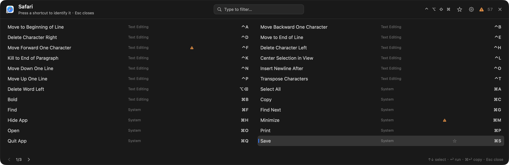
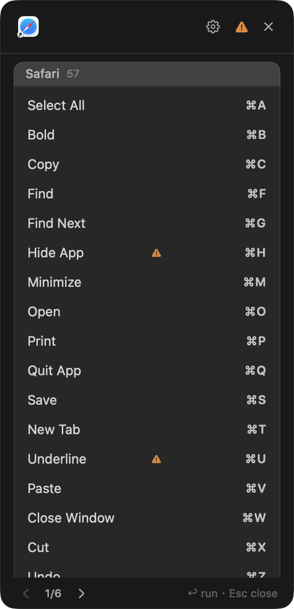
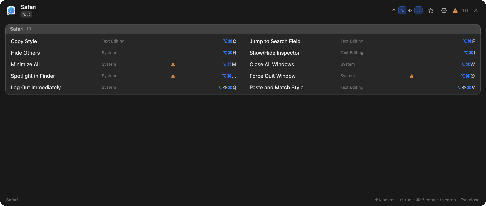
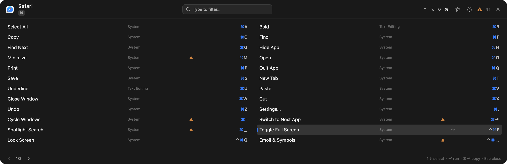
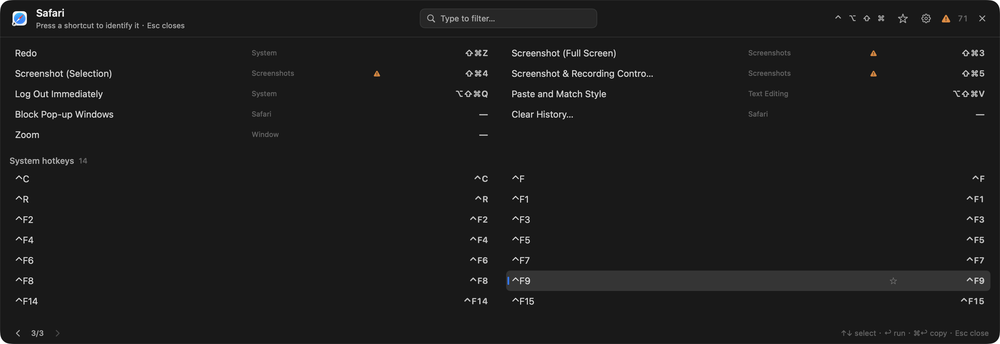
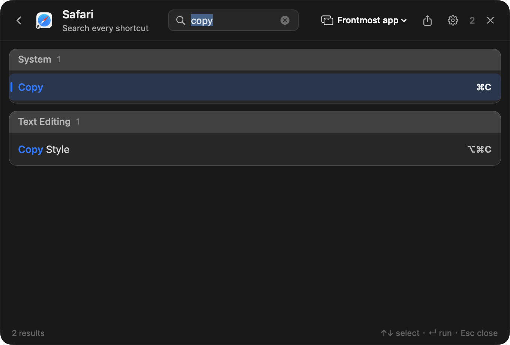
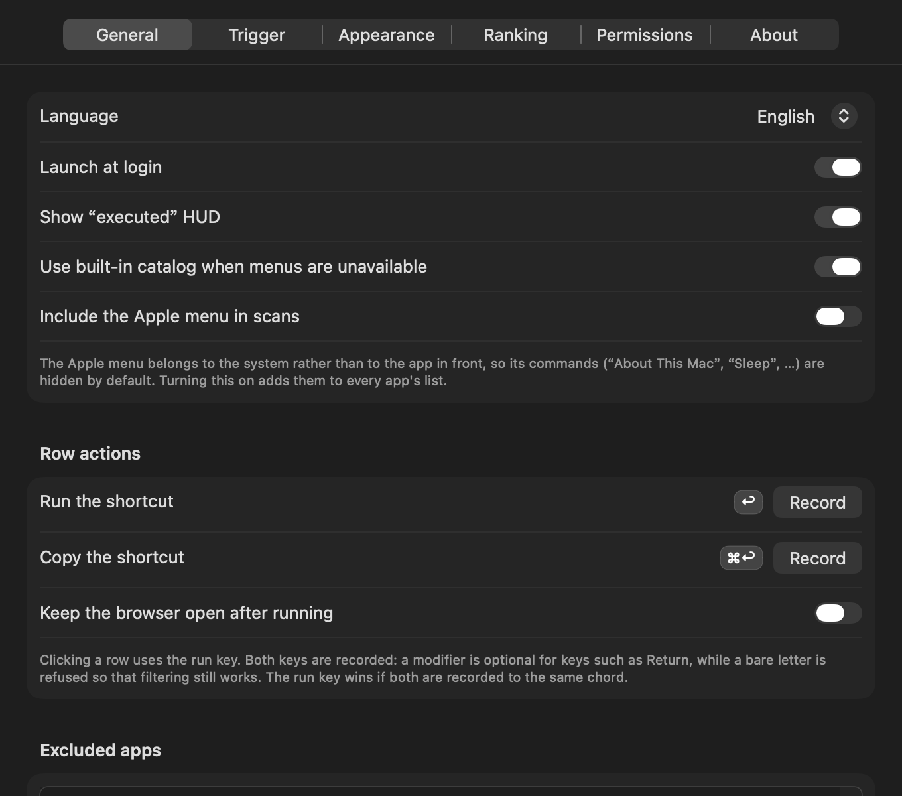
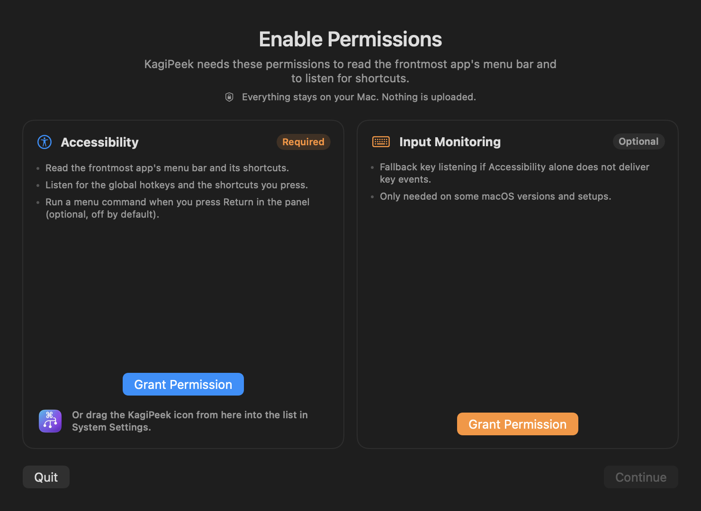

# KagiPeek

[](https://github.com/suliveevil/KagiPeek/actions/workflows/ci.yml)
[](https://github.com/suliveevil/KagiPeek/releases/latest)

**Press and hold a modifier. See what the app you are in can do next.**

KagiPeek is a menu bar utility for macOS. It reads the frontmost app's menu bar through the Accessibility API and shows its shortcuts in a floating panel. The panel is **persistent**: it stays until you press Esc, toggle it off, or complete a shortcut. Holding modifiers to summon it narrows the list to that modifier level, which-key style; the hotkey and double-⌘ summon it with no prefix, showing every shortcut as a complete combination (⌘C). There is no per-app shortcut pack to install and no configuration file to maintain: if an app has a menu bar, KagiPeek can show its shortcuts, including chords, disabled items, and conflicts — and it can trigger any of them, including the commands that have no shortcut at all.

The shortcut engine was rewritten around live menu scanning. It then became actionable: the panel became keyboard-driven and clickable, and conflicts began to include macOS system hotkeys. The panel became persistent, with four placement modes, tokenized and pinyin-aware search, Hyper-key matching, per-app statistics in Application Support, guided permission onboarding, an About tab, and a panel/search switch hotkey. It is now organised into two cards ordered by the shortcut itself; the "look at another app" job moved out of the browser window and into the search palette; Settings split into eight tabs — statistics and conflicts each answer a different question and got a page of their own; a conflict names its **type** and a likely winner instead of a severity; the cross-app scan is cached on disk behind a manual rescan; system hotkeys have real names; and triggering the command became the primary goal: every menu row is run by pressing the menu item itself, so commands with no shortcut at all are reachable too.

`macOS 14.0 Sonoma or later · menu bar agent · local by default · GPL-2.0`

[Features](#features) · [Install](#install) · [First run](#first-run) · [Usage](#usage) · [Configuration](#configuration) · [Privacy](#privacy) · [Architecture](#architecture) · [Development](#development) · [FAQ](#faq) · [中文](#中文)

## Screenshots

<!-- Screenshots are captured by the app's built-in preview mode. -->


*Hold a modifier and pause. The panel covers the focused window by default and narrows to the level of the modifiers you are holding, so each row shows what can come next. It stays until you press Esc or toggle it off; ↑/↓ select a row and the run key acts on it. Two cards, never interleaved: the app's commands under its name, then the system's hotkeys under theirs — named where macOS lets us name them (Minimize, Spotlight, Force Quit) and an em dash where it does not. The list is a reference card rather than a copy of the menu bar: rows are ordered by the shortcut itself and the menu a command lives in is the middle column, so ⌘C, ⌘V and ⌘X sit together whichever menu they came from. Each row is three aligned columns — the command, its menu, and the shortcut — so a long command name never pushes its neighbours' menu paths out of line.*


*The title bar gives way in a fixed order: the result count, then the modifier chips and the favourites toggle, then the app name and subtitle. The settings and close buttons stay reachable — in a one-column panel they used to be pushed outside it. The menu column is dropped rather than squeezed, and the "has a sub-level" chevron moves into the trailing slot so it survives.*


*A shortcut can be assembled like an Emacs key sequence: tap ⌥, tap ⌘, then press C — or hold all three at once. Tapping a modifier (or clicking its chip in the title bar) ticks it: the list narrows exactly as it does while a key is held, but the tick survives the release, and the next tap narrows on top of it. Ticks light the chip and are folded into the next stroke, which the panel then replays in full. ⌫ undoes the tick you made last, and everything but the last one is still there, so you can narrow again without reopening the panel.*


*Holding is the other half of the same list: it narrows while the key is down and widens again the moment you let go — a way of looking, where a tick is a way of composing. The row keeps its whole chord either way; the modifier you are holding is lit in place rather than stripped, so a row narrowed by ⌘ still reads ⌘C and not just C.*


*Triggering the command is the point, so the panel does not stop at commands that can be typed: a menu item with no key equivalent still gets a row, sorted after every shortcut, with a dash where the chord would be. Running it presses the menu item itself — the only way to reach it — and the same press is tried first for every other menu row, with the chord replayed only as a fallback.*


*The palette names the app it is answering for — icon, name, and an app menu for the frontmost app plus every running regular app — and groups its matches into cards by menu. Return closes the palette and triggers the command in the app you scoped to: pressing the menu item when there is one, replaying the chord otherwise. The palette has no copy action; the export button writes what you are looking at to Markdown.*


*Settings has eight tabs: General, Trigger, Appearance, Statistics, Conflicts, Permissions, Diagnostics, and About. General holds the two recorded row keys; statistics and conflicts each have a page of their own.*


*One card per permission, with what it is for, whether it is required, and a Grant button that opens the exact System Settings pane.*

## Features

| | |
| --- | --- |
| **Live menu scanning** | Reads the frontmost app's menu bar recursively through Accessibility: menu titles, key equivalents, enabled state, and the position of each item in the tree. Items with no key equivalent are kept too — they are triggered by pressing the menu item, not by typing. Any app with a standard menu bar works without a custom shortcut list. |
| **Fallback catalog** | 100 built-in system, text-editing, Finder, and screenshot shortcuts fill in when an app has no menu bar or a scan cannot run. Can be disabled. |
| **Persistent panel** | The panel stays until you press Esc or toggle it off. **Holding modifiers to summon it seeds a prefix**, so the list narrows to the rows those modifiers can start; the hotkey (⌃⌥⌘K) and double-⌘ summon it with an empty prefix, so every row is a complete combination (for example ⌘C). Releasing the modifiers widens the list back without closing the panel. |
| **Which-key narrowing** | While the prefix is modifier-only, rows shrink to those whose first stroke uses a superset of the held modifiers, each row shows the next key, and the surviving rows are highlighted (the highlighted set and the visible set are the same at that level). Pressing a real key descends into that level. Completing a shortcut emphasises its description for about 0.4 s, then the panel closes. |
| **Chords** | Multi-stroke shortcuts such as `⌘K ⌘C` descend one level at a time. ⌫ goes back, Esc closes; a breadcrumb shows the current prefix. Pressing a key with no match leaves the panel open. |
| **Menu grouping** | Each row keeps the menu it came from as its middle column, with the app's own menu titles in the app's language. There is no per-menu heading to re-order the list: the shortcut decides the order. |
| **Two sections** | The app's commands come first under its name; macOS's own hotkeys follow under **System hotkeys**, so a chord the system owns is visible next to the one the app owns. |
| **Pagination** | Long lists are paged with `1/3` and clickable ‹ ›, and the scroll wheel works. The panel never grows past the screen. |
| **Actionable panel** | ↑/↓ select a row, ←/→ page, the run key (↩ by default) runs the row, the copy key (⌘↩ by default) copies it, and Esc closes. While no modifier is held these keys are consumed by the panel, so the front app never sees them; a completed shortcut is not consumed, so the app still receives it. Clicking a row does what the run key does. Both keys are **recorded** under **Settings → General → Row actions**. |
| **Executed HUD** | A 0.75 s toast such as `⌘C Copy ✓` confirms a panel execution or a copy. Can be disabled. |
| **Conflict detection** | Bindings that claim the same combination are marked ⚠︎, and **Settings → Conflicts** lists every member with a **type** rather than a severity: menu-order overlap, a system shortcut shadowing a menu item, a third-party tool shadowing either, system-vs-system, system-vs-tool, tool-vs-tool, and a tool fighting itself. Each finding names the layer and says which one wins — or honestly says "same layer, registration order decides, no file records it". The list filters by type and by **related app**, and only rescans when you ask. |
| **System hotkey conflicts** | Spotlight, Mission Control, and other enabled system shortcuts are read through Carbon and compared with the app's menu shortcuts. Matching chords are marked ⚠︎, and the conflict list names the system source. Because a system shortcut sits below a menu item, the verdict is not "maybe" but **the menu item never fires**. Rows in the panel's system section are named from a built-in table (⌘Space → Spotlight, ⌥⌘⎋ → Force Quit); a chord the table cannot name shows **—** rather than repeating the shortcut as its own description. |
| **Third-party config sources** | Karabiner-Elements, skhd, Keyboard Maestro, BetterTouchTool, Hammerspoon and Alfred keep their shortcuts in a file rather than a menu, and all of them hook the keyboard *below* an app's menu. KagiPeek parses those files (read-only) so a conflict list can say "⌘⇧4 will never reach Safari" instead of just "two things want ⌘⇧4". On by default, with the list of what was read at the top of **Settings → Conflicts**. |
| **Combo lookup** | Type a combination into search — `cmd shift 4`, `⌘⇧4`, `opt cmd t` — and KagiPeek answers who owns it, or that it is free, instead of returning an empty list that reads as "not scanned". |
| **Live shortcut test** | **Test this combo** on any conflict row watches one real keypress: two listen-only event taps detect whether another app swallowed the key, and above that layer the verdict falls back to what came to the front. Each result is tagged **confirmed / informative / inconclusive**, so a guess is never presented as a fact. While it listens, every panel behaviour is suspended, so KagiPeek can never be the thing that ate the key. |
| **Disabled items** | Menu items that the app reports as disabled (`AXEnabled == false`) are greyed out, and can optionally be hidden. |
| **Ranking** | Sort order decides the statistics page — both the per-app list and the rows inside an app. **Smart order** is the default (decayed usage frequency, so recently used shortcuts rise and stale ones fade), then Most used first, Key order, and Alphabetical. The panel is always in key order and the palette always in match order; neither follows this setting. |
| **Usage statistics** | Counts and last-used times per binding, **grouped by app** (system and built-in rows appear as *System / built-in*), each app a collapsible row. Stored in `~/Library/Application Support/KagiPeek/usage.json`, capped at 800 entries, resettable. No raw key events or text. |
| **Search** | A global search palette (default ⌃⌥⌘F), also reachable by pressing `/` in the panel. Results arrive in cards by menu, with a banner when the query spells out a combination. Space-separated terms in any order, `+` as a separator, modifier aliases (com/cmd/cm/⌘, op/alt/⌥, …), full pinyin and pinyin initials for Chinese titles, and word initials for English titles; all terms must match. Return closes the palette and **triggers** the selected command in the app you scoped to — pressing the menu item when there is one, replaying the chord otherwise. The palette has no copy action; the panel does. |
| **Multi-app scope** | The palette's app menu lists the frontmost app and every running regular app, and its header shows the scoped app's icon and name, so the list always says whose shortcuts these are. Choosing another app re-scans and re-ranks for it, and running a row activates that app first. The panel still follows the real frontmost app. |
| **Export Markdown** | The palette's export button saves the current matches (or the scoped app's whole sheet when the field is empty) through a save panel: grouped by menu, `Shortcut` / `Action` columns, unavailable items marked. |
| **Excluded apps and ignored commands** | An app can be excluded from scanning altogether (a list you fill from a file picker, not a text field of bundle identifiers), and a command title can be ignored either globally or for one app — so "Reload Page" in Safari can be hidden without hiding Xcode's. |
| **Panel placement** | Cover the front window (default), a fixed width/height, the whole visible screen, or beside the front window (the older behavior, which also avoids the focused control). |
| **Appearance and accessibility** | Dark translucent panel that honours Reduce Transparency and Increase Contrast. |
| **English and 简体中文** | The interface follows the system language and can be overridden in Settings. |
| **Permission onboarding** | Accessibility is required (menu reading and the global key tap). Input Monitoring is offered as a fallback when a system does not deliver key events with Accessibility alone. **Request Access** opens both the system prompt and the matching System Settings pane, and a draggable KagiPeek icon can be dropped into the permission list. Each grant is detected and explained separately; the panel hides while secure input is active. |
| **Hyper-key ready** | Hotkeys with three or more modifiers also match when the event carries extra modifiers, so a Karabiner-style Hyper (⌃⌥⇧⌘) triggers a recorded ⌃⌥⌘ hotkey. Hotkeys with fewer than three modifiers stay strict. |
| **Panel/search switch** | One hotkey (default ⌃⌥⌘S, recorded in Settings) moves between the two surfaces: search visible → panel, panel visible → search, neither → panel. Only one is ever on screen. |
| **Eight settings tabs** | General, Trigger, Appearance, Statistics, Conflicts, Permissions, Diagnostics, and About. Diagnostics turns logging on or off, offers a verbose mode, shows the log folder and exports a report; About shows the icon, version and build, system version, the manual update check, the data folder, the repository and license, and the same **Export diagnostics…**. |
| **Private by design** | All shortcut processing is local; settings and statistics are plain JSON files in Application Support, and the only network request is the update check you trigger yourself. No account, no telemetry, no keystroke log. KagiPeek injects a shortcut only when you ask it to run a row, and only that one chord. |

## Install

### Requirements

- macOS 14.0 Sonoma or later.
- Accessibility permission (required). Input Monitoring is an optional fallback if key events are not delivered on your system. Both are explained on first launch.
- The app is a menu bar agent: no Dock icon, and no window when it launches — the menu bar icon is the way in (Settings → General → **Show a Dock icon as well** adds one back).

### Download a release

1. Download the latest DMG from [Releases](https://github.com/suliveevil/KagiPeek/releases/latest) and verify it against the published `.sha256` file (`shasum -a 256 KagiPeek-*.dmg`).
2. Open the DMG and drag **KagiPeek** into **Applications** — launch it from there, not from inside the DMG.
3. Launch KagiPeek and grant Accessibility as described below. Add Input Monitoring only if the panel does not appear.

Notarized builds open normally. A build that is not notarized is blocked on first launch with an "unverified developer" notice — the app is still fully signed, only Apple's check is missing. After the block dialog, use either:

- **No Terminal:** open **System Settings → Privacy & Security**, scroll down to the KagiPeek notice, and click **Open Anyway** (the right-click → Open shortcut does not exist on macOS 15), or
- **Terminal:** `xattr -dr com.apple.quarantine /Applications/KagiPeek.app`

> **Upgrading or replacing an existing copy?** macOS ties privacy grants to the app's code signature. If you replace KagiPeek with a build signed differently — a local or ad-hoc rebuild, or an install over a release signed by another identity — the old Accessibility grant is no longer valid: open **System Settings → Privacy & Security → Accessibility**, remove the stale KagiPeek entry if present, and enable the new app again. Without this step no panel will appear. A normal signed update keeps the bundle identifier and its grant.

### Homebrew

Homebrew support is provided as a cask template in [`Distribution/kagipeek.rb`](Distribution/kagipeek.rb). The cask is **not published to a tap yet**; until it is, use the DMG or build from source. Once the tap exists:

```bash
brew tap suliveevil/tap
brew install --cask kagipeek
```

### Build from source

```bash
git clone https://github.com/suliveevil/KagiPeek.git
cd KagiPeek
open KagiPeek.xcodeproj
```

Select the **KagiPeek** scheme and run. Xcode handles signing for local development. To build and package a DMG without opening Xcode:

```bash
./scripts/build_release.sh
# produces build/KagiPeek-<version>.dmg
```

To build and replace `/Applications/KagiPeek.app` in one step:

```bash
./scripts/install.sh
```

The release script signs with a Developer ID Application identity when one is available and attempts notarization; otherwise it falls back to ad-hoc signing. Ad-hoc builds work locally but are not notarized, and macOS may require you to re-grant permissions after replacing the app.

## First run

1. Launch KagiPeek. Nothing opens on screen — the app appears in the menu bar. If Accessibility is missing, the menu bar menu carries a **Grant permission…** item instead. **Settings → Permissions** lists both grants and their current status.
2. Open **Settings → Permissions** and click **Request** next to Accessibility. KagiPeek shows the system authorization prompt and opens the matching **System Settings → Privacy & Security → Accessibility** pane; enable KagiPeek there. If it is not listed, drag the KagiPeek icon from the Permissions tab into the list, or add the app with **+**.
3. Try holding ⌘. If the panel appears, nothing else is needed.
4. If no panel appears, quit KagiPeek, click **Request** next to **Input Monitoring** (it opens that pane too), enable KagiPeek, and reopen the app. This is the fallback for systems that do not deliver key events with Accessibility alone.
5. Check **Settings → Permissions** to confirm the current state.

The full walkthrough, including reset commands and signature-related re-granting, is in [docs/PERMISSIONS.md](docs/PERMISSIONS.md).

## Usage

### Trigger

| Trigger | How | Notes |
| --- | --- | --- |
| Hold modifiers and pause | Hold ⌃, ⌥, or ⌘ (or a combination) without pressing another key for 0.5 s | Default trigger mode. Delay is adjustable from 0.1 s to 1.5 s. The held modifiers seed the prefix, so the panel narrows to that level. A lone ⇧ is ignored. |
| Double-⌘ | Tap ⌘ twice within 300 ms | Alternative trigger mode. |
| Panel hotkey | ⌃⌥⌘K by default | Alternative trigger mode. The panel stays open until Esc or the hotkey again. Switching the frontmost app (or the desktop) closes the panel; summon it again to see the new app's shortcuts. |
| Search | ⌃⌥⌘F by default | Opens the search panel independently. The hotkey is configurable. |
| Switch panel/search | ⌃⌥⌘S by default | Search visible → panel; panel visible → search; neither → panel. Only one is ever on screen. Recordable in Settings. |
| Off | — | Disables triggering; the menu bar item and settings remain available. |

### The panel

- **One level at a time.** With an empty prefix every row is a complete combination (for example ⌘C). Holding modifiers to summon the panel seeds the prefix, so the panel narrows to that level and each row shows the next key; the hotkey and double-⌘ summon it empty.
- **The panel is persistent.** It stays on screen until you press Esc or press the panel hotkey (or the switch hotkey) again. Releasing the modifiers widens the list back rather than closing it, there is no idle timer, and the old auto-hide delay is gone.
- **Selection and highlight are different things.** Highlight follows your fingers (the rows the current prefix can reach); selection is your cursor, moved with ↑/↓ or the pointer. Both are drawn so that neither moves the row text.
- **The shortcut still reaches the app.** KagiPeek only observes keys; it does not remap them. Completing a shortcut closes the panel and lets the same key event continue to the front app, so the command runs immediately, exactly as if the panel had not been open.
- **Chords stay open.** If a stroke is the first step of a multi-stroke shortcut, the panel descends one level and shows what can follow; a breadcrumb shows the prefix. ⌫ goes back one stroke, and only while no other modifier is held, so ⌘⌫ stays an ordinary shortcut. Esc closes the panel whatever the modifiers.
- **Keyboard and mouse.** ↑/↓ select, ←/→ page (or `;` / `'`), the run key acts on the selection, Esc closes. With no modifier held these keys are consumed by the panel and never reach the front app; clicking a row does the same as the run key.
- **`/` opens the search palette.** The panel has no text field of its own: `/` swaps it for the search palette with the cursor already in the field, and the palette keeps whatever you last searched for. Press `/` again while the field is empty to go back to the panel (there is nothing to lose); once you have typed a query, `/` is an ordinary character and the back chevron in the title bar takes you back. ⌘/ is never taken; it belongs to the front app.
- **Run or copy.** The run key (↩ by default) closes the panel and triggers that row's command in the front app: it presses the menu item itself when the scan kept one — which is also the only way to run a command that has no shortcut at all — and replays the chord into the app as a fallback. The copy key (⌘↩ by default) writes the chord to the clipboard and leaves the panel open (a row with no shortcut has nothing to copy and says so). Both are **recorded** under **Settings → General → Row actions**; the footer always spells out the two keys you actually chose. A row with further steps descends a level instead of running, and a disabled row is ignored.
- **Completing a shortcut.** The row is highlighted for about 0.4 s, the panel closes, and the shortcut runs in the app. A key with no match leaves the panel open instead of closing it.
- **Two cards, and paging.** The app's commands come first, ordered by the shortcut (shorter chords first, then ⌘ → ⌥ → ⌃ → ⇧, then the key); the system's hotkeys follow under **System hotkeys**. The menu a command lives in is the middle column, not a heading. Long lists show `1/3` with clickable ‹ › and respond to the scroll wheel.
- **Conflicts and disabled items.** Conflicting rows carry ⚠︎. Disabled menu items are greyed out unless you choose to hide them.
- **Long descriptions** are truncated with an ellipsis according to the display setting.

### Search

Press ⌃⌥⌘F, or press `/` while the panel is open. Search covers the scoped app's menu shortcuts and the built-in catalog; the palette's app menu switches scope.

- **Terms are unordered and all must match.** `com op x`, `op cm x`, and `cmd+opt+x` all find ⌘⌥X; `+` is just another separator.
- **Modifier aliases** are understood: `com`/`cmd`/`command`/`cm`/`⌘`, `op`/`opt`/`option`/`alt`/`⌥`, `ct`/`ctl`/`ctrl`/`control`/`⌃`, `sh`/`sft`/`shift`/`⇧`.
- **Chinese titles match pinyin:** full pinyin (`jian qie`), spaced syllables, and initials (`jq` for 剪切). **English titles match word initials:** `fs` finds Find Similar. Better matches rank first, regardless of the order you type the terms in.
- ↑/↓ moves the selection.
- **Return runs the selected command.** The palette closes, the app you scoped the search to is activated, and the command is triggered there: the menu item is pressed when the row has one, otherwise that one chord is replayed into the app.
- **The palette has no copy action.** To copy a chord without running it, use the copy key in the panel (⌘↩ by default); ↩ runs.
- **Panel and search are mutually exclusive.** Opening one closes the other. The switch hotkey (⌃⌥⌘S by default) moves from search to panel, from panel to search, or opens the panel when neither is visible.
- Search queries are not recorded.

### Menu bar and settings

KagiPeek is an `LSUIElement` agent: no Dock icon, and no window at launch. The menu bar icon is the whole interface — **Search Shortcuts…**, **Shortcut Panel**, **Permission guide** (only while Accessibility is missing), **Pause Hints** / **Resume Hints**, **Settings…**, and **Quit KagiPeek**. Its own menu bar (the app menu inside its windows) carries ⌘, for Settings and ⇧⌘F for the search palette.

Settings has eight tabs:

| Tab | What it covers |
| --- | --- |
| General | Interface language, launch at login, executed HUD, built-in catalog, **Include the Apple menu in scans**, **Show a Dock icon as well**, **row actions** (the two recorded row keys), **excluded apps** (added from a file picker, removed from the list), and **ignored commands** (one collapsible group per scope: global rules, then one per app). |
| Trigger | Trigger mode, hold delay, double-tap window, and the panel, search, and switch panel/search hotkeys. |
| Appearance | Key style, panel theme, key position, columns, rows per page, description length, disabled items, favourites pinning, whether filters may hide favourites, and **panel placement** (cover the front window, fixed size with width and height, fill the screen, or beside the front window). |
| Statistics | Sort order and **statistics by app** (presses and shortcut counts, one collapsible section per app), **Show data folder**, **Reset statistics**, and **Restore defaults**. |
| Conflicts | Third-party **config file sources** first (which files were read, how many bindings each contributed, a rescan), then the conflict list with a **type** filter, a **related app** filter, the scan timestamp, a manual rescan, and a **Test this combo** action on each row. |
| Permissions | Accessibility and Input Monitoring status, **Request Access** (system prompt plus the matching System Settings pane), and the draggable KagiPeek icon. |
| Diagnostics | Logging on/off, verbose logging, the log folder, and **Export diagnostics…**. |
| About | Icon, version and build number, system version, **Check for updates**, data folder, repository and license, and the same diagnostics export. |

The search palette is the surface you get from the search hotkey or by pressing `/` in the panel. Its header names the app it is answering for and offers an app menu with the frontmost app and every running regular app, so any of them can be searched; **Export Markdown** writes what you are looking at to a file. Its rows are live: hover to select, click or press Return to run the command in that app, Esc to close. The update check is manual: it compares the latest GitHub release and never downloads or installs anything.

## Configuration

| Setting | Values | Default |
| --- | --- | --- |
| Trigger mode | Hold modifiers / Double-⌘ / Global hotkey / Off | Hold modifiers |
| Hold delay | 0.1–1.5 s | 0.5 s |
| Double-tap window | 0.15–0.8 s | 0.3 s |
| Panel hotkey | Any key combination | ⌃⌥⌘K |
| Search hotkey | Any key combination | ⌃⌥⌘F |
| Switch panel/search hotkey | Any key combination | ⌃⌥⌘S |
| Panel placement | Cover the front window / Fixed size / Fill the screen / Beside the front window | Cover the front window |
| Fixed panel width | 320–4000 pt | 720 |
| Fixed panel height | 240–3000 pt | 620 |
| Show "executed" HUD | On / Off | On |
| Sort order | Smart order / Most used first / Key order / Alphabetical | Smart order |
| Built-in catalog when menus are unavailable | On / Off | On |
| Include the Apple menu in scans | On / Off | Off |
| Show a Dock icon as well | On / Off | Off |
| Show unavailable menu items | On / Off | On (greyed out) |
| Key style | Symbols / Words | Symbols |
| Columns | 1–3 | 2 |
| Max rows per page | 6–60 | 24 |
| Max description length | 8–80 characters | 30 |
| Language | System / English / 简体中文 | System |
| Run a row | Any recorded key | ↩ |
| Copy a row | Any recorded key | ⌘↩ |
| Key position | Left / Right | Right |
| Panel theme | Graphite / Midnight / Paper | Graphite |
| Pin favourites to the top | On / Off | On |
| Filters can hide favourites | On / Off | Off |
| Ignored commands | A title, global or bound to one app | None |
| Launch at login | On / Off | Off |
| Excluded apps | Bundle identifiers, chosen from a file picker | None |
| Scan config files (Conflicts tab) | On / Off | On |
| Diagnostics logging | On / Off | On |
| Verbose diagnostics | On / Off | Off |
| Usage statistics | Per-app counts and shortcut totals, 800-entry cap | Stored in Application Support |

## Privacy

- **Shortcut handling is local.** KagiPeek has no accounts, no analytics, and no telemetry, and no data about you, your apps, or your shortcuts is sent anywhere. The single exception is the update check you trigger yourself: it fetches the public GitHub release document once and uploads nothing. The source is available under the GPL-2.0.
- **Accessibility is used for menus and the key tap.** KagiPeek reads menu titles, key equivalents, and enabled state from the frontmost app, and uses a global key tap to see modifier and key state. It does not read documents, text fields, or window contents.
- **Scans stay short-lived, and never leave the machine.** Menu data is cached in memory per app for 20 seconds, and on disk — per app, for up to 10 minutes, in `~/Library/Application Support/KagiPeek/menu-cache/` — so re-opening the panel for the same app, or relaunching KagiPeek, skips the AX walk. The disk copy records only what a scan already read (menu titles, paths, key equivalents, enabled state); it is dropped when a scan-shaping setting changes, when it turns 10 minutes old, or when you press "Restore defaults". There is no live menu observer, and nothing is uploaded.
- **Two files hold user data; the rest is derived.** Settings and statistics are `settings.json` and `usage.json` in `~/Library/Application Support/KagiPeek/`, written atomically. A file that cannot be decoded is renamed `*.corrupt-<timestamp>.json` and kept rather than silently discarded. Next to them sit `conflicts-cache.json` (the last cross-app conflict scan, so opening the page does not rescan every app), `menu-cache/` (menu scans, valid for 10 minutes) and `logs/` + `crash/` (the diagnostic log, the last 30 action names, the crash reports) — all reproducible, all safe to delete, and the log can be switched off in **Settings → Diagnostics**.
- **Keys are observed, not recorded.** The global key tap computes the current modifier/key state and detects the recorded hotkeys and the panel's own navigation keys. It passes events through to the front app except those keys, which it consumes so the app does not also receive them. KagiPeek never stores a stream of key presses or typed text.
- **Exactly one chord is injected, and only on request.** When you press the run key, click a row, or press Return in the search palette, KagiPeek posts that row's chord once (`CGEvent`, HID event tap) into the front app and finishes. It does not replay what you type, it does not inject anything while you are just browsing the panel, and the copy key never injects at all. This is the one place where the app synthesises input, and it exists so a menu item can be run without reaching for the menu.
- **Statistics are minimal.** KagiPeek stores a use count and last-used timestamp per `bundleID|chord`, grouped by app, capped at 800 entries and resettable in Settings. No raw key events or queries are stored.
- **Secure input wins.** When macOS reports secure input (password fields, login windows), the panel hides.
- **Config files are opened read-only, and only for the scan.** When third-party scanning is on, KagiPeek reads `karabiner.json`, `skhdrc`, Keyboard Maestro's macro library, BetterTouchTool's data store, `init.lua` and Alfred workflow `info.plist` under your home directory to find their shortcuts. It opens them read-only (BetterTouchTool's database with SQLite's read-only flag), never writes, never uploads, and keeps only chord, title and owning tool in memory — no file is copied out and nothing from those files is written to disk. Turning the setting off forgets everything found and opens no such file again. |
- **No telemetry or upload.** No shortcut, app, or usage data is ever sent; the update check only reads a public release document.

See [docs/PRIVACY.md](docs/PRIVACY.md) for the complete list of what is read, written, sent and injected, [docs/PERMISSIONS.md](docs/PERMISSIONS.md) for the grants, and [docs/ARCHITECTURE.md](docs/ARCHITECTURE.md) for the implementation.

## Compared with vim-which-key and emacs which-key

KagiPeek borrows the interaction model, not the implementation.

| | KagiPeek | vim-which-key | emacs which-key |
| --- | --- | --- | --- |
| Scope | Any macOS app with a menu bar | Neovim keymaps | Emacs keymaps |
| Data source | Live Accessibility menu scan plus a built-in fallback | Lua configuration | Active keymaps |
| Invocation | Hold modifiers, double-⌘, a global hotkey, or the panel/search switch hotkey | Leader key | Prefix key timeout |
| Navigation | Persistent panel, complete shortcuts, progressive highlight, chord breadcrumb, ⌫ back, Esc close | Prefix menus | Prefix menus |
| Display | Floating panel: over the focused window, beside it, or filling the screen | Popup window | Minibuffer or child frame |
| Ranking | Key order in the panel; Smart order / Most used / Key order / Alphabetical for the statistics page | Configured order | Configured order |
| Configuration | Settings UI, no config file | Lua tables | Emacs variables |
| Platform | macOS 14+ | Neovim | Emacs |

Unlike the editor plugins, KagiPeek cannot define or remap shortcuts. It reflects what the app already exposes, which is why it works immediately across applications and why it cannot invent a shortcut that is not in a menu.

The editor plugins only display the next keys; KagiPeek also runs the menu command for you — by pressing the menu item, so a command with no shortcut is reachable too.

## Architecture

At a high level:

```
frontmost app → Accessibility menu scan → ShortcutEngine (20 s memory cache,
                                              ├─→ PanelSections  → panel card 1: the app's rows
                                              │                    (PanelOrdering: chord order)
                                              ├─→ SearchCorpus   → search palette (app scope,
                                              │                    grouped into cards by menu)
                                              └─→ ConflictDetector → Settings → Conflicts
global keys   → key tap → HotkeyMatcher ──────┤
                                              ├─→ UsageStore → Application Support/usage.json
                                              └─→ PanelPlacement → cover / fixed / fill / beside
system hotkeys → Carbon CopySymbolicHotKeys ──┤
                                              ├─→ SystemHotkeyNames → panel card 2 + conflicts
                                              └─→ MenuScanCache    → menu-cache/ (10 min)
```

The shortcut engine, chord resolution and ordering, formatting, description cleanup, conflict detection and caching policy, search corpus (tokenizer and pinyin), hotkey matching, panel placement, usage statistics, Markdown export, and semantic versions live in a pure SwiftPM target (`KagiPeekCore`) with XCTest coverage. AppKit, Accessibility, and SwiftUI code sit above it: `SystemHotkeyReader` (Carbon system shortcuts, plus the `SystemHotkeyNames` table that gives them names), `AppDirectory` (running-app list for the search scope and the conflict scan), `ConflictCache` (the cross-app scan kept between launches), `MenuScanCache` (menu scans on disk), and `UpdateChecker` (the manual update check). The full component map, threading model, cache invalidation, and known limitations are in [docs/ARCHITECTURE.md](docs/ARCHITECTURE.md).

## Development

Run the pure-logic tests:

```bash
swift test
```

If `swift test` fails because `xcode-select` points at the Command Line Tools, prefix it with `DEVELOPER_DIR=/Applications/Xcode.app/Contents/Developer`, or select Xcode with `sudo xcode-select -s /Applications/Xcode.app/Contents/Developer`.

Build the app the same way CI does:

```bash
xcodebuild \
  -project KagiPeek.xcodeproj \
  -scheme KagiPeek \
  -configuration Debug \
  -derivedDataPath build/DerivedData \
  CODE_SIGNING_ALLOWED=NO \
  build
```

CI runs on `macos-15`: checkout, a Debug build and a Release build with signing disabled, then `swift test`, then a coverage report for the pure target (the job warns below 70% line coverage). It runs on every branch push and on pull requests. See [`.github/workflows/ci.yml`](.github/workflows/ci.yml).

If `sandbox-exec` is unavailable in your environment (the build system wraps every compile in it, and nested sandboxing can be denied), both `xcodebuild` and `swift test` fail with `sandbox_apply: Operation not permitted`. Workarounds: `swift test --disable-sandbox`, and `./scripts/build_swiftc.sh Release`, which compiles the same sources with `swiftc` and loads the SwiftUI macros explicitly. `scripts/install.sh` falls back to it automatically when `xcodebuild` cannot build.

Release:

```bash
./scripts/build_release.sh   # build/KagiPeek-<version>.dmg
```

Contributor setup, layering rules, the "a setting change touches five places" checklist, and the test policy are in [docs/CONTRIBUTING.md](docs/CONTRIBUTING.md); the release steps are in [docs/RELEASING.md](docs/RELEASING.md). What shipped, and what to check when upgrading, is in [docs/RELEASES.md](docs/RELEASES.md). When something does not work, start with [docs/TROUBLESHOOTING.md](docs/TROUBLESHOOTING.md).

The Homebrew cask template is [`Distribution/kagipeek.rb`](Distribution/kagipeek.rb). It must be copied into a tap before `brew install --cask kagipeek` works.

`build_release.sh` also accepts `KAGIPEEK_SIGN_IDENTITY` (choose a signing identity), `KAGIPEEK_NOTARY_PROFILE` (a `notarytool` keychain profile to notarize with), and `KAGIPEEK_SKIP_DMG=1` (build the app only).

## FAQ

**Nothing happens when I hold a modifier.**
Check the trigger mode, whether Accessibility is granted, and whether you are in a secure input field. If the panel still does not appear, grant Input Monitoring and relaunch. If the app has no menu bar, enable the built-in catalog. Full checklist in [docs/FAQ.md](docs/FAQ.md#nothing-happens-when-i-hold-a-modifier).

**Why does app X show no shortcuts?**
KagiPeek can only show shortcuts the app exposes in its menu bar. Shortcuts implemented in custom views, web content, or games are invisible; menu items without key equivalents are not guessed. See [docs/FAQ.md](docs/FAQ.md#why-does-app-x-show-no-shortcuts).

**Does it upload anything or record what I type?**
No. Shortcut handling is local, the key tap only passes events through (except KagiPeek's own hotkeys and the panel's navigation keys; a completed shortcut still reaches the app), and statistics contain only counts and timestamps grouped by app. Settings and statistics are two JSON files in Application Support. The one thing it does synthesise is the single chord you asked it to run — pressing the run key or clicking a row replays that row's shortcut into the front app once. The only network request is the update check you press yourself. See [Privacy](#privacy).

**Why doesn't the panel close by itself?**
The auto-hide delay was removed. The panel is persistent and closes when you press Esc or toggle it off with the panel/switch hotkey. Switching apps or desktops closes it too, because its contents belong to the app it was opened over. Releasing modifiers just widens the list back.

**Where is my data, and will reinstalling lose it?**
In `~/Library/Application Support/KagiPeek/` as `settings.json` and `usage.json`. They are independent of the app bundle and the preference domain, so reinstalling or updating keeps them; only deleting the folder removes them. See [Privacy](#privacy) and [docs/FAQ.md](docs/FAQ.md).

**Can I use a Hyper key?**
Yes. Record a three-modifier hotkey in **Settings → Trigger**; a Karabiner-style Hyper (⌃⌥⇧⌘) event carries a superset of modifiers and still matches. Hotkeys with fewer than three modifiers are matched strictly.

**Why isn't it on the Mac App Store?**
Reading another app's menu bar and observing global keys are not possible inside the App Sandbox. KagiPeek ships outside the store with the sandbox disabled.

**What does ⚠︎ mean?**
Another binding — an app menu item, an enabled macOS system shortcut, or a third-party tool's config — uses the same key combination. macOS decides which one wins; KagiPeek only reports the conflict, names its type and the layer. Details are in **Settings → Conflicts**.

**Do I need to grant permissions again after updating?**
The upgrade that changed the bundle identifier **always** required re-granting Accessibility. Builds since then keep the same identifier, so a signed update normally keeps its grant; ad-hoc local builds may still be treated as new after every rebuild. See [docs/FAQ.md](docs/FAQ.md#do-i-need-to-grant-permissions-again-after-an-update).

## License

GPL-2.0. See [LICENSE](LICENSE).

## Credits

KagiPeek started as a project by [Voltline](https://github.com/Voltline/KagiPeek). This fork is maintained by [suliveevil](https://github.com/suliveevil). The shortcut engine was rewritten, then made actionable, and the panel became persistent; the interaction model is inspired by [vim-which-key](https://github.com/folke/which-key.nvim) and [emacs which-key](https://github.com/justbur/emacs-which-key).

The conflict-checking work — naming the type of a clash, the event-stack layer model, third-party config scanning, the combo lookup and the live keypress test — takes its ideas from [HotkeyClash](https://github.com/Wunderlandmedia/HotkeyClash) by Wunderlandmedia, also GPL-2.0. The layer ranking and the head/tail event-tap technique are theirs; the code here is written for KagiPeek's own models.

Five ideas come from [Menu-Bar-Search](https://github.com/BenziAhamed/Menu-Bar-Search): addressing a command by its position in the menu tree (`pathIndices` → `axPath`), weighting search hits by how close a matched menu level is to the command itself, caching scans on disk behind a control file that records the settings they were written under, resolving the app that owns the menu bar rather than merely the frontmost one, and reporting *why* a scan came back empty instead of showing an empty list. The `showAppleMenu` setting is its toggle, defaults off.
---

## 中文

[English](#kagipeek) · [中文](#中文)

**按住修饰键，看看当前 App 接下来能做什么。**

KagiPeek 是一个 macOS 菜单栏工具。它通过辅助功能（Accessibility）API 读取前台 App 的菜单栏，用浮层面板显示它的快捷键。面板是**持久**的：它会一直保持到你按 Esc、再次切换关闭或完成一条快捷键。按住修饰键唤出时，按住的修饰键会成为前缀，把列表收窄到那一层（which-key 行为）；用热键或连按 ⌘ 唤出时没有前缀，每行显示完整组合键（如 ⌘C）。不需要为每个 App 安装快捷键包，也不需要维护配置文件：只要 App 有菜单栏，KagiPeek 就能显示它的快捷键，包括多段组合键、不可用项和冲突。

快捷键引擎被重写：实时菜单扫描取代静态列表，面板新增多段组合键导航与搜索。这套引擎随后变得真正可用：面板可以用键盘驱动、也能点击执行，冲突检测纳入系统热键。面板变为持久面板，并新增四种面板位置、分词与拼音搜索、Hyper 键匹配、按 App 统计的 Application Support 存储、授权引导、独立的“关于”标签页，以及切换面板/搜索的热键。面板如今整理为两张卡片、行按快捷键本身排序；把“看另一个 App”的职责从速查窗口搬进搜索面板（用 App 范围切换）；把设置拆成八个标签页（统计与冲突各回答一个问题，各自独立成页）；冲突不再只报严重度，而是给出**类型**和可能的胜负；跨 App 扫描结果落盘、只在需要时手动重扫；系统热键也有了真正的名字；同时把“执行命令”变成首要目标——菜单行一律按菜单项本身执行，因此没有任何快捷键的命令同样可以触发。

> 系统要求：macOS 14.0 Sonoma 或更高版本。仅支持 macOS，不提供 Windows 或 Linux 版本。

界面截图见上。

### 功能

| | |
| --- | --- |
| **实时菜单扫描** | 通过辅助功能递归读取前台 App 的菜单栏：菜单标题、快捷键与启用状态。任何标准菜单栏 App 装完即用，无需手工维护列表。 |
| **内置兜底目录** | 100 条系统、文本编辑、Finder 与截图快捷键，在 App 没有菜单栏或扫描失败时使用。可在设置中关闭。 |
| **持久面板** | 面板一直保持到按 Esc 或再次切换关闭。**按住修饰键唤出时，按住的修饰键会成为前缀**，列表收窄到该层；热键（⌃⌥⌘K）与连按 ⌘ 唤出时没有前缀，每行是完整组合键（如 ⌘C）。松开修饰键会恢复完整列表，面板不关闭。 |
| **which-key 收窄** | 前缀只有修饰键时，行集合收窄到“首步修饰键包含当前按住项”的快捷键，每行显示下一个键，且这些行同时高亮（该层可见集合与高亮集合相同）。按下实体键后进入该层；完成一条快捷键时该行说明以强调色显示约 0.4 秒，然后面板关闭。 |
| **多段组合键** | 支持 `⌘K ⌘C` 这类 chord：按下 ⌘K 后若还有后续组合，面板留在原位并进入下一层。⌫ 返回上一层，Esc 关闭面板，顶部面包屑显示当前前缀；没有匹配的按键时面板保持打开。 |
| **菜单分组** | 每一行把所属菜单作为中间一列保留，菜单名来自 App 自己的菜单结构与语言。没有按菜单划分的分组标题，也就没有东西能打乱行的顺序。 |
| **两张卡片** | App 自己的命令在前，标题是 App 名；macOS 的系统热键在后，标题是**系统热键**。系统占用的组合键因此能和 App 占用的并排比较。 |
| **自动分页** | 条目过多时显示 `1/3` 与可点击的 ‹ ›，也支持滚轮翻页，面板不会撑破屏幕。 |
| **可操作面板** | ↑/↓ 选择行、←/→ 翻页、执行键（默认 ↩）执行选中行——有菜单项就按菜单项，否则回放该组合键——复制键（默认 ⌘↩）只复制到剪贴板、Esc 关闭。没有按住其他修饰键时这些键由面板消费，不会传到前台 App，而完整快捷键不会被吞掉。点击某一行等同于执行键。两个行键都可以在 **设置 → 通用 → 行操作** 里录制。 |
| **已执行提示** | 面板里执行或复制一条快捷键后，按设置显示 0.75 秒的轻提示，例如 `⌘C 复制 ✓`。可关闭。 |
| **冲突检测** | 同一组合键被多条绑定占用时显示 ⚠︎，**设置 → 冲突** 列出全部成员，并且按**类型**而不是严重度分类：菜单项顺序重叠、系统快捷键压住菜单项、第三方工具压住菜单项或系统键、系统对系统、系统对工具、工具对工具，以及工具自己和自己打架。每条结论都标明所在层并给出胜负——或者诚实说明“同一层，注册顺序决定，而配置文件不记录它”。列表可以按类型和**相关 App** 筛选，且只在你要求时重扫。 |
| **系统热键冲突** | 通过 Carbon 读取已启用的系统快捷键（聚焦搜索、调度中心、截图……），与当前 App 的菜单快捷键比对；相同组合键标 ⚠︎，冲突列表标明系统来源。由于系统快捷键位于菜单项之下，结论不是“可能”，而是**该菜单项永远不会触发**。面板系统卡片里的行由内置名字表命名（⌘Space → 聚焦搜索、⌥⌘⎋ → 强制退出）；表里认不出的组合键显示 **—**，而不是把快捷键自己再当一次描述。 |
| **第三方配置来源** | Karabiner-Elements、skhd、Keyboard Maestro、BetterTouchTool、Hammerspoon、Alfred 的快捷键写在文件里而非菜单里，并且都挂在菜单之下的键盘层。KagiPeek 只读解析这些文件，于是冲突列表能说“⌘⇧4 永远到不了 Safari”，而不只是“两个东西都要 ⌘⇧4”。默认开启，读到了哪些文件列在 **设置 → 冲突** 顶部。 |
| **组合键查询** | 在搜索里直接输入组合键（`cmd shift 4`、`⌘⇧4`、`opt cmd t`），KagiPeek 回答它被谁占用、或者它是空的，而不是返回空列表让人以为没扫描。 |
| **实时按键测试** | 冲突列表里每一行都可以“测试这个组合键”：按一次，看它到底被谁拿走——两个只读监听点判断是否有其他 App 吞掉了这个键，更高层则回退到“谁被激活”。每条结论标注**已确认 / 有信息量 / 无法判断**，绝不把猜测当成事实。 |
| **不可用项** | 菜单项当前不可用（`AXEnabled == false`）时灰显，也可设置为隐藏。 |
| **排序** | 排序方式决定统计页——按 App 的列表和 App 内部的行都是。默认**智能排序**（使用频率随时间衰减，常用条目靠前、陈旧条目自然下沉），还可选高频优先、按键顺序、字母顺序。面板始终按按键顺序、搜索面板始终按匹配度，两者都不受这个设置影响。 |
| **使用统计** | 记录每条绑定的使用次数与最近使用时间，并**按 App 分组**（系统与内置条目显示为“系统 / 内置”），每个 App 一行可折叠。保存在 `~/Library/Application Support/KagiPeek/usage.json`，上限 800 条，可重置；不记录原始按键内容。 |
| **搜索** | 全局搜索面板（默认 ⌃⌥⌘F），也可以在面板里按 `/` 进入。结果按菜单分卡片，查询本身写成一个组合键时上方会给出结论横幅。空格分词、顺序无关，`+` 也可作分隔符；支持修饰键别名（com/cmd/cm/⌘、op/alt/⌥……）、中文全拼与拼音首字母、英文单词首字母，所有词项必须同时命中。Return 关闭面板并在你选定的那个 App 里**执行**选中项：有菜单项就按菜单项，否则回放该组合键。搜索面板没有复制功能；面板有。 |
| **多 App 范围** | 搜索面板顶部的 App 菜单列出前台 App 与所有正在运行的常规 App，标题处显示当前范围 App 的图标与名字，列表永远说清“这是谁家的快捷键”。换一个 App 会重新扫描并重新排序，执行时会先把那个 App 激活。浮层面板仍跟随真实前台 App。 |
| **导出 Markdown** | 搜索面板的导出按钮通过存储面板把当前结果（输入框为空时是所选 App 的整张表）写成 Markdown：按菜单分组，表格列为 Shortcut / Action，不可用项标注 unavailable。 |
| **排除 App 与忽略命令** | 可以整体排除某个 App（列表通过文件选择器添加，不需要手输 bundle id），也可以忽略某个命令标题——全局忽略，或只对某个 App 忽略，于是 Safari 的“重新载入页面”可以隐藏而 Xcode 的不受影响。 |
| **面板位置** | 覆盖前台窗口（默认）、固定长宽、铺满屏幕，或前台窗口旁边（旧版行为，仍会尽量避开当前焦点元素）。 |
| **外观与辅助功能** | 深色玻璃浮层，遵循“降低透明度”和“增强对比度”辅助功能设置。 |
| **中文 / English** | 界面跟随系统语言，也可在设置中覆盖。 |
| **权限引导** | 辅助功能为必需项（读取菜单栏 + 创建全局按键监听）；输入监控是可选的兜底项，仅在系统无法通过辅助功能接收按键事件时需要。点“请求授权”会同时弹出系统授权提示并直接打开对应的系统设置页面，还可以把设置页里的 KagiPeek 图标直接拖进系统设置的列表。两项分开检测、分开说明；检测到安全输入时自动隐藏面板。 |
| **支持 Hyper 键** | 三个及以上修饰键的热键，允许事件携带超集修饰键，因此 Karabiner 之类工具产生的 hyper（⌃⌥⇧⌘）可以匹配录制的 ⌃⌥⌘ 热键；少于三个修饰键时仍然严格匹配。 |
| **面板/搜索切换** | 一个热键（默认 ⌃⌥⌘S，可在设置中录制）在两种面板之间切换：搜索可见 → 面板，面板可见 → 搜索，都不可见 → 打开面板。同一时间只显示一个。 |
| **八个设置标签页** | 通用、触发、外观、统计、冲突、权限、诊断、关于。诊断页可以开关日志、打开详细日志、查看日志目录并导出报告；关于页包含图标、版本与构建号、系统版本、检查更新、数据目录、仓库与协议，以及同一个**导出诊断…**。 |
| **隐私优先** | 快捷键处理全部本地完成；设置与统计是 Application Support 里的两个 JSON 文件，唯一联网是你手动触发的检查更新；无账号、无遥测、无按键记录。只有你主动执行某一行时，KagiPeek 才会把该行的那一条组合键注入前台 App。 |

### 安装

#### 系统要求

- macOS 14.0 Sonoma 或更高版本。
- 辅助功能权限（必需）。输入监控是可选的兜底项，仅在系统收不到按键事件时才需要。两项都会在首次启动时说明。
- 这是菜单栏 App，没有 Dock 图标，启动时不打开任何窗口——入口就是菜单栏图标（**设置 → 通用 → 同时在 Dock 显示图标** 可以把图标加回来）。

#### 下载 DMG

1. 从 [Releases](https://github.com/suliveevil/KagiPeek/releases/latest) 下载最新 DMG，并用发布的 `.sha256` 文件校验（`shasum -a 256 KagiPeek-*.dmg`）。
2. 打开 DMG，把 **KagiPeek** 拖进 **Applications**——从 Applications 里启动，不要在 DMG 里直接运行。
3. 启动并先授予辅助功能；如果面板不弹出，再添加输入监控。

已公证的版本可以直接打开。未公证的版本首次启动会被 Gatekeeper 以“无法验证开发者”拦截——App 本身是完整签名的，缺的只是 Apple 的公证。看到拦截提示后，任选其一：

- **不用终端：** 打开**系统设置 → 隐私与安全性**，拉到底找到 KagiPeek 的提示，点**仍要打开**（macOS 15 上“右键 → 打开”已不可用），或
- **用终端：** `xattr -dr com.apple.quarantine /Applications/KagiPeek.app`

> **覆盖安装或替换旧版本？** macOS 把隐私授权绑定到 App 的代码签名。如果用签名不同的构建替换 KagiPeek（本地或 ad-hoc 重新构建，或覆盖签名身份不同的版本），旧的辅助功能授权会失效：请打开**系统设置 → 隐私与安全性 → 辅助功能**，移除残留的 KagiPeek 条目（如果有），再重新勾选新的 App。不做这一步，面板不会出现。使用同一签名身份的正常升级 Bundle ID 不变，授权会保留。

#### Homebrew

Homebrew 安装使用 cask 模板 [`Distribution/kagipeek.rb`](Distribution/kagipeek.rb)。该 cask **尚未发布到 tap**；发布前请使用 DMG 或从源码构建。发布后可以：

```bash
brew tap suliveevil/tap
brew install --cask kagipeek
```

#### 从源码构建

```bash
git clone https://github.com/suliveevil/KagiPeek.git
cd KagiPeek
open KagiPeek.xcodeproj
```

选择 **KagiPeek** scheme 运行；本地开发时由 Xcode 处理签名。也可以不打开 Xcode，直接构建并打包 DMG：

```bash
./scripts/build_release.sh
# 产物：build/KagiPeek-<version>.dmg
```

构建并覆盖安装到 `/Applications/KagiPeek.app`：

```bash
./scripts/install.sh
```

发布脚本在存在 Developer ID Application 身份时用它签名并尝试公证；否则回退到 ad-hoc 签名。ad-hoc 版本可以本地运行，但未公证，替换安装后可能需要重新授权。

### 首次运行与授权

1. 启动 KagiPeek。屏幕上不会出现任何窗口，App 出现在菜单栏。缺少辅助功能时，菜单里会多出一项**权限向导**。**设置 → 权限** 中列出两项授权及当前状态。
2. 打开 **设置 → 权限**，点击辅助功能旁的**请求授权**：KagiPeek 会弹出系统授权提示，并直接打开“隐私与安全性 → 辅助功能”，在那里打开 KagiPeek。如果列表里没有，可以把权限页里的 KagiPeek 图标直接拖进列表，或用 **+** 添加 `/Applications/KagiPeek.app`。
3. 试着按住 ⌘。如果面板出现，就不需要再授权。
4. 如果面板不出现，退出 KagiPeek，点击输入监控旁的**请求授权**（同样会直接打开对应页面），打开 KagiPeek 后再重新启动 App。这是系统无法仅靠辅助功能传递按键事件时的兜底。
5. 回到 **设置 → 权限** 查看当前授权状态。

完整步骤、重置命令以及签名变化导致的重新授权说明见 [docs/PERMISSIONS.md](docs/PERMISSIONS.md)。

### 触发方式

| 触发方式 | 操作 | 说明 |
| --- | --- | --- |
| 按住修饰键停顿 | 按住 ⌃、⌥ 或 ⌘（或组合）0.5 秒，期间不按其他键 | 默认触发模式，停顿时间可在 0.1–1.5 秒之间调整。按住的修饰键会成为前缀，列表收窄到该层；单独按 ⇧ 不算。 |
| 连按两次 ⌘ | 300 毫秒内连按两次 ⌘ | 可选触发模式。 |
| 面板热键 | 默认 ⌃⌥⌘K | 可选触发模式；面板保持到按 Esc 或再次按热键。切换前台 App 或桌面会关闭面板，重新唤出即可看到新 App 的快捷键。 |
| 搜索 | 默认 ⌃⌥⌘F | 独立打开搜索面板，热键可自定义。 |
| 切换面板/搜索 | 默认 ⌃⌥⌘S | 搜索可见 → 面板；面板可见 → 搜索；都不可见 → 打开面板。同一时间只显示一个，热键可在设置中录制。 |
| 关闭 | — | 停用触发，菜单栏与设置仍可使用。 |

### 面板操作

- 一次只显示一层：没有前缀时每行是完整组合键（如 ⌘C）；按住修饰键唤出时前缀就是这些修饰键，面板收窄到该层，每行显示“下一个键”。
- 面板是持久的：它会一直保持到按 Esc，或再次按面板热键（或切换热键）。松开修饰键只会恢复完整列表，不会关闭面板；没有静置计时器。
- 选中与高亮是两种状态：高亮跟随当前前缀能到达的行，选中是你用 ↑/↓ 或鼠标移动的光标。两者都不占布局宽度，所以鼠标扫过时文字不会左右跳。
- 快捷键照常传给 App：KagiPeek 只观察按键，不重映射。完成一条快捷键时面板关闭，同一个按键事件继续传给前台 App，所以命令会像面板从未打开一样立即执行。
- 支持多段组合键：若按下的键是某条 chord 的第一步，面板进入下一层显示可继续的按键，面包屑显示当前前缀；⌫ 退回上一层（只在没有其他修饰键时生效，⌘⌫ 仍是普通快捷键）。Esc 无论带不带修饰键都会关闭面板。
- 键盘与鼠标：↑/↓ 选择、←/→（或 `;` / `'`）翻页、执行键执行选中行、Esc 关闭。没有按住其他修饰键时这些键由面板消费，不会传给前台 App；鼠标点击某一行等同于执行键。
- 执行还是复制由按键决定：执行键（默认 ↩）关闭面板并把该行的组合键回放给前台 App，复制键（默认 ⌘↩）只写入剪贴板、面板保持打开。两个键都可以在 **设置 → 通用 → 行操作** 里录制，底部提示会渲染你实际选的键。还有后续步骤的行会进入下一层而不是执行，不可用的行会被忽略。
- 完成一条快捷键：该行高亮约 0.4 秒后，面板关闭，快捷键在 App 里执行；没有匹配的按键时面板保持打开，而不是关闭。
- 两张卡片：App 自己的命令在前，按快捷键排序（步数少的在前，再按 ⌘ → ⌥ → ⌃ → ⇧，最后比按键）；系统热键在**系统热键**标题下随后。命令所属菜单是中间一列，不是分组标题。条目过多时自动分页，底部显示 `1/3` 和可点击的 ‹ ›，鼠标滚轮也可翻页。
- 同一组合键被多条绑定占用时，该条右侧显示 ⚠︎。
- 菜单项不可用时灰显，可按设置隐藏；超长描述按设置截断并加省略号。

### 搜索

按 ⌃⌥⌘F，或在面板里按 `/`。搜索范围是所选 App 的菜单快捷键与内置目录；面板顶部的 App 菜单可以换范围。

- **空格分词、顺序无关、全部命中**：`com op x`、`op cm x`、`cmd+opt+x` 都能找到 ⌘⌥X；`+` 只是另一个分隔符。
- **支持修饰键别名**：`com`/`cmd`/`command`/`cm`/`⌘`、`op`/`opt`/`option`/`alt`/`⌥`、`ct`/`ctl`/`ctrl`/`control`/`⌃`、`sh`/`sft`/`shift`/`⇧`。
- **中文标题支持全拼与首字母**：`jian qie`、`jianqie`、`jq` 都能找到“剪切”；**英文标题支持单词首字母**：`fs` 能找到 Find Similar。更好的匹配排在前面，与你输入词项的顺序无关。
- ↑/↓ 选择。
- **Return 执行选中项**：搜索面板关闭，先把搜索范围内那个 App 激活，再在它里面执行——有菜单项就按菜单项，否则回放该组合键。
- **搜索面板没有复制功能。** 只想复制组合键而不执行，请用面板的复制键（默认 ⌘↩）；↩ 是执行。
- **面板与搜索互斥**：打开一个会关闭另一个；切换热键（默认 ⌃⌥⌘S）在两者之间切换——搜索可见时切到面板、面板可见时切到搜索、都不可见时打开面板。
- 不记录搜索内容。

### 菜单栏与设置

KagiPeek 是 `LSUIElement` 菜单栏 App，没有 Dock 图标，启动时不打开窗口。菜单栏图标就是全部入口：**搜索快捷键…**、**快捷键面板**、**权限向导**（仅在缺少辅助功能时出现）、**暂停提示** / **恢复提示**、**设置…**、**退出 KagiPeek**。App 自己的菜单栏（窗口内的应用菜单）带 ⌘, 打开设置、⇧⌘F 打开搜索面板。

设置共有八个标签页：

| 标签页 | 内容 |
| --- | --- |
| 通用 | 界面语言、开机自启动、执行轻提示、内置目录、**扫描时包含 Apple 菜单**、**同时在 Dock 显示图标**、**行操作**（两个可录制的行键）、**排除的 App**（用文件选择器添加、在列表里删除）、**忽略的命令**（按范围折叠：先是全局规则，再是一个 App 一组）。 |
| 触发 | 触发方式、停顿时间、双击间隔，以及面板、搜索、切换面板/搜索三个可录制热键。 |
| 外观 | 按键显示、面板主题、按键位置、列数、每页行数、描述长度、不可用项、收藏置顶、收藏可被搜索/过滤隐藏，以及**面板位置**（覆盖前台窗口、固定长宽并设置宽高、铺满屏幕、前台窗口旁边）。 |
| 统计 | 排序方式与**按 App 统计**（次数与快捷键数，每个 App 一节可折叠）、**显示数据目录**、**重置统计**、**恢复默认设置**。 |
| 冲突 | 先列第三方**配置文件来源**（读了哪些文件、各贡献多少条、重扫按钮），再是冲突列表：**类型**筛选、**相关 App** 筛选、扫描时间、手动重扫，以及每行的**测试这个组合键**。 |
| 权限 | 辅助功能与输入监控状态、**请求授权**（系统提示 + 直接打开对应系统设置页），以及可拖拽的 KagiPeek 图标。 |
| 诊断 | 日志开关、详细日志、日志目录与**导出诊断…**。 |
| 关于 | 图标、版本与构建号、系统版本、**检查更新**、数据目录、仓库与协议，以及同一个诊断导出。 |

搜索面板是搜索热键（或在面板里按 `/`）打开的那一层。它的标题处显示当前范围 App 的图标与名字，并提供前台 App 与所有运行中常规 App 的菜单，任意一个都能搜索；**导出 Markdown** 把当前看到的内容写成文件。行是活的：悬停选中、点击或按 Return 在那个 App 里执行命令、Esc 关闭。检查更新是手动操作：只比对 GitHub 最新版本，不会自动下载或安装。

### 配置项

| 设置 | 取值 | 默认 |
| --- | --- | --- |
| 触发方式 | 按住修饰键 / 连按两次 ⌘ / 全局热键 / 关闭 | 按住修饰键 |
| 停顿时间 | 0.1–1.5 秒 | 0.5 秒 |
| 双击间隔 | 0.15–0.8 秒 | 0.3 秒 |
| 面板热键 | 任意组合键 | ⌃⌥⌘K |
| 搜索热键 | 任意组合键 | ⌃⌥⌘F |
| 切换面板/搜索热键 | 任意组合键 | ⌃⌥⌘S |
| 面板位置 | 覆盖前台窗口 / 固定长宽 / 铺满屏幕 / 前台窗口旁边 | 覆盖前台窗口 |
| 固定面板宽度 | 320–4000 pt | 720 |
| 固定面板高度 | 240–3000 pt | 620 |
| 执行后显示轻提示 | 开 / 关 | 开 |
| 排序方式 | 智能排序 / 高频优先 / 按键顺序 / 字母顺序 | 智能排序 |
| 菜单不可用时使用内置快捷键目录 | 开 / 关 | 开 |
| 扫描时包含 Apple 菜单 | 开 / 关 | 关 |
| 同时在 Dock 显示图标 | 开 / 关 | 关 |
| 显示当前不可用的菜单项 | 开 / 关 | 开（灰显） |
| 按键显示 | 符号 / 文字 | 符号 |
| 列数 | 1–3 | 2 |
| 每页最大行数 | 6–60 | 24 |
| 描述最大长度 | 8–80 个字符 | 30 |
| 界面语言 | 跟随系统 / English / 简体中文 | 跟随系统 |
| 执行键 | 任意录制键 | ↩ |
| 复制键 | 任意录制键 | ⌘↩ |
| 按键位置 | 左 / 右 | 右 |
| 面板主题 | Graphite / Midnight / Paper | Graphite |
| 收藏置顶 | 开 / 关 | 开 |
| 收藏可被搜索/过滤隐藏 | 开 / 关 | 关 |
| 忽略的命令 | 一个标题，可全局或绑定到某个 App | 无 |
| 开机自启动 | 开 / 关 | 关 |
| 排除的 App | Bundle ID，通过文件选择器添加 | 无 |
| 扫描配置文件（冲突页） | 开 / 关 | 开 |
| 诊断日志 | 开 / 关 | 开 |
| 详细诊断日志 | 开 / 关 | 关 |
| 使用统计 | 按 App 的次数与快捷键数，上限 800 条 | 保存在 Application Support |

### 隐私

- **快捷键处理全部本地完成。** 无账号、无分析、无遥测，也不会把你、你的 App 或快捷键数据发到任何地方；唯一例外是你手动触发的检查更新，它只读取一次公开的 GitHub 发布信息，不上传任何内容。源码以 GPL-2.0 开放。
- **辅助功能用于菜单与按键监听。** 只读取前台 App 的菜单标题、快捷键和启用状态，并用全局事件 tap 获取修饰键与按键状态；不读取文档、文本框或窗口内容。
- **扫描结果只在本机短暂停留。** 菜单数据按 App 在内存中缓存 20 秒，同时按 App 在磁盘上缓存最多 10 分钟（`~/Library/Application Support/KagiPeek/menu-cache/`），这样再次打开同一 App 的面板、或重启 KagiPeek 都不必重新遍历菜单栏。磁盘副本只记录扫描已经读到的内容（菜单标题、路径、快捷键、启用状态），在扫描相关设置变更、超过 10 分钟或点击“恢复默认设置”时被丢弃。没有实时监听菜单变化，也不会上传任何内容。
- **只有两个文件是用户数据，其余都是可再生的。** 设置与统计保存为 `~/Library/Application Support/KagiPeek/settings.json` 与 `usage.json`，采用原子写；无法解码的文件会改名为 `*.corrupt-<时间戳>.json` 保留下来，而不是悄悄丢弃。同目录下还有 `conflicts-cache.json`（上一次跨 App 冲突扫描，避免每次打开冲突页都重扫）、`menu-cache/`（菜单扫描，10 分钟内有效）、以及 `logs/` + `crash/`（诊断日志、最近 30 条动作名、崩溃报告）——这些都可以重建、可以随时删除，日志也能在 **设置 → 诊断** 里关掉。
- **观察按键，但不记录。** 全局按键 tap 只用于计算当前修饰键/按键状态并识别录制的热键；除 KagiPeek 自己的面板/搜索/切换热键、以及活动面板的导航键外，事件都原样放行，只有这些键会被吞掉，避免前台 App 也收到它们；完成一条快捷键的按键**不会**被吞掉。不保存按键流或输入文本。
- **只注入你要求的那一条组合键。** 当你按执行键、点击某一行，或在搜索面板按 Return 时，KagiPeek 会把那一行的组合键注入前台 App 一次（`CGEvent`，HID event tap），然后结束。它不会回放你输入的内容，只是浏览面板时不会注入任何按键，复制键也完全不注入。这是本 App 唯一合成输入的地方，目的是让你不必去点菜单。
- **统计最小化。** 仅保存每条 `bundleID|chord` 的使用次数与最近使用时间，按 App 分组，上限 800 条，可在设置中重置；不保存原始按键事件或搜索内容。
- **安全输入优先。** 检测到安全输入（密码框、登录窗口）时自动隐藏面板。
- **不上传。** 不会把任何快捷键、App 或使用数据发送出去；检查更新只读取公开的发布信息。

完整清单（读什么、写什么、发什么、注入什么）见 [docs/PRIVACY.md](docs/PRIVACY.md)；授权见 [docs/PERMISSIONS.md](docs/PERMISSIONS.md)；实现见 [docs/ARCHITECTURE.md](docs/ARCHITECTURE.md)。发布内容与升级须知见 [docs/RELEASES.md](docs/RELEASES.md)；出问题先看 [docs/TROUBLESHOOTING.md](docs/TROUBLESHOOTING.md)，参与开发看 [docs/CONTRIBUTING.md](docs/CONTRIBUTING.md)。

### 与 vim-which-key / emacs which-key 对照

KagiPeek 借鉴的是交互方式，不是实现。

| | KagiPeek | vim-which-key | emacs which-key |
| --- | --- | --- | --- |
| 作用范围 | 任意有菜单栏的 macOS App | Neovim keymap | Emacs keymap |
| 数据来源 | 实时辅助功能菜单扫描 + 内置兜底 | Lua 配置 | 当前 keymap |
| 触发 | 按住修饰键 / 连按 ⌘ / 全局热键 / 切换面板搜索热键 | Leader 键 | 前缀键超时 |
| 导航 | 持久面板、which-key 收窄、chord 面包屑、⌫ 返回、Esc 关闭 | 前缀菜单 | 前缀菜单 |
| 显示 | 覆盖前台窗口、贴在其旁边或铺满屏幕的浮层 | 弹窗 | minibuffer 或 child frame |
| 排序 | 面板按按键顺序、搜索按匹配度；统计页可选智能排序 / 高频优先 / 按键 / 字母 | 配置顺序 | 配置顺序 |
| 配置 | 设置界面，无配置文件 | Lua 表 | Emacs 变量 |
| 平台 | macOS 14+ | Neovim | Emacs |

与编辑器插件不同，KagiPeek 不定义也不重映射快捷键。它只反映 App 已经暴露的菜单快捷键，因此装完即用，也无法凭空创造菜单里没有的快捷键。

编辑器插件只能显示下一层按键；KagiPeek 还能替你执行菜单命令——把该行的快捷键回放给前台 App。

### 架构简述

```
前台 App → 辅助功能菜单扫描 → ShortcutEngine（内存缓存 20 秒，
                                ├─→ PanelSections → 面板卡片 1：App 自己的行
                                │                   （PanelOrdering：按键顺序）
                                ├─→ SearchCorpus  → 搜索面板（App 范围，按菜单分卡片）
                                └─→ ConflictDetector → 设置 → 冲突
全局按键 → 按键 tap → HotkeyMatcher ┤
                                ├─→ UsageStore → Application Support/usage.json
                                └─→ PanelPlacement → 覆盖 / 固定 / 铺满 / 贴靠
系统热键 → Carbon CopySymbolicHotKeys ┤
                                ├─→ SystemHotkeyNames → 面板卡片 2 + 冲突检测
                                └─→ MenuScanCache     → menu-cache/（10 分钟）
```

组合键解析与排序、格式化、描述清洗、冲突检测与缓存策略、搜索语料（分词与拼音）、热键匹配、面板定位、使用统计、Markdown 导出与语义化版本比较都放在无 AppKit 依赖的纯 SwiftPM target（`KagiPeekCore`）中，由 XCTest 覆盖；AppKit、辅助功能与 SwiftUI 位于其上层：`SystemHotkeyReader`（Carbon 系统热键，配合给出名字的 `SystemHotkeyNames` 表）、`AppDirectory`（搜索范围与冲突扫描用的运行中 App 列表）、`ConflictCache`（跨启动保留的冲突扫描结果）、`MenuScanCache`（落盘的菜单扫描）与 `UpdateChecker`（手动检查更新）。完整组件图、线程模型、缓存失效策略与已知限制见 [docs/ARCHITECTURE.md](docs/ARCHITECTURE.md)。

### 开发与发布

运行纯逻辑测试：

```bash
swift test
```

如果 `swift test` 因 `xcode-select` 指向 Command Line Tools 而失败，可在命令前加 `DEVELOPER_DIR=/Applications/Xcode.app/Contents/Developer`，或用 `sudo xcode-select -s /Applications/Xcode.app/Contents/Developer` 切换到 Xcode。

按 CI 的方式构建：

```bash
xcodebuild \
  -project KagiPeek.xcodeproj \
  -scheme KagiPeek \
  -configuration Debug \
  -derivedDataPath build/DerivedData \
  CODE_SIGNING_ALLOWED=NO \
  build
```

CI 使用 `macos-15`：checkout、带 `CODE_SIGNING_ALLOWED=NO` 的 `xcodebuild` 构建，然后 `swift test`。见 [`.github/workflows/ci.yml`](.github/workflows/ci.yml)。

发布：

```bash
./scripts/build_release.sh   # 产物 build/KagiPeek-<version>.dmg
```

Homebrew cask 模板在 [`Distribution/kagipeek.rb`](Distribution/kagipeek.rb)，需要放进 homebrew tap 后才能通过 `brew install --cask kagipeek` 安装。

`build_release.sh` 还支持 `KAGIPEEK_SIGN_IDENTITY`（指定签名身份）、`KAGIPEEK_NOTARY_PROFILE`（`notarytool` 钥匙串配置，用于公证）和 `KAGIPEEK_SKIP_DMG=1`（只构建 App）。

### 常见问题

**按住修饰键没反应？** 检查触发方式、辅助功能是否已授权，以及是否处于密码框等安全输入状态；如果仍不弹，再授予输入监控并重启 App。如果 App 没有菜单栏，请开启内置目录。完整排查见 [docs/FAQ.md](docs/FAQ.md)。

**为什么某个 App 没有快捷键？** KagiPeek 只能显示 App 在菜单栏中暴露的快捷键；自定义视图、网页内容或游戏里的快捷键不可见，没有快捷键的菜单项也不会被猜测。

**会上传数据或记录我输入的内容吗？** 不会。快捷键处理全部本地完成，按键 tap 只把事件原样放行（KagiPeek 自己的热键与面板的导航键除外，完整快捷键仍会传给 App），统计只有按 App 分组的次数与时间；设置和统计是 Application Support 里的两个 JSON 文件；唯一联网是你手动触发的检查更新。

**面板为什么不自动关闭？** 自动关闭延时已被删除。面板是持久的，只在按下完整快捷键、按 Esc，或用面板/切换热键关闭时才消失；修饰键想什么时候松开都可以。

**我的数据在哪？重装会丢吗？** 在 `~/Library/Application Support/KagiPeek/` 下的 `settings.json` 与 `usage.json`。它们独立于 App 包和偏好域，重装或升级都不会丢，只有删除该目录才会清空。详见 [隐私](#隐私) 与 [docs/FAQ.md](docs/FAQ.md)。

**能用 Hyper 键吗？** 可以。在**设置 → 触发**里正常录制一个三修饰键热键即可；Karabiner 之类工具产生的 hyper（⌃⌥⇧⌘）事件携带超集修饰键，仍能匹配。少于三个修饰键的热键仍然严格匹配。

**为什么不上架 Mac App Store？** 读取其他 App 菜单栏与监听全局按键无法在 App Sandbox 中实现，因此以沙盒关闭的方式在商店外分发。

**⚠︎ 是什么意思？** 同一组合键被另一条绑定（菜单项或已启用的系统热键）占用。实际由 macOS 决定谁生效，KagiPeek 只负责报告，并在冲突列表中标明来源。

**更新后需要重新授权吗？** 跨 Bundle ID 变更的那次升级**必须**重新授权辅助功能。此后 Bundle ID 不变，签名版本正常升级通常不需要重新授权；ad-hoc 本地构建仍可能被 macOS 视为新 App，需要在辅助功能中移除旧条目、重新添加（如果也授权了输入监控，同样处理）。详见 [docs/FAQ.md](docs/FAQ.md)。

## 许可证

GPL-2.0，见 [LICENSE](LICENSE)。

## 致谢

KagiPeek 最初由 [Voltline](https://github.com/Voltline/KagiPeek) 发起，本仓库是 [suliveevil](https://github.com/suliveevil) 维护的 fork。快捷键引擎被重写、随后变得可操作，面板也变为持久面板；交互方式受 [vim-which-key](https://github.com/folke/which-key.nvim) 与 [emacs which-key](https://github.com/justbur/emacs-which-key) 启发。

冲突检查——按类型而非严重度分类、事件栈分层模型、第三方配置文件扫描、组合键查询与实时按键测试——思路来自 [HotkeyClash](https://github.com/Wunderlandmedia/HotkeyClash)（Wunderlandmedia，同样 GPL-2.0）。分层模型与首/尾双事件 tap 的技巧来自该项目，代码是按 KagiPeek 自己的模型重写的。

五项设计借鉴自 [Menu-Bar-Search](https://github.com/BenziAhamed/Menu-Bar-Search)：用命令在菜单树中的位置来定位它（`pathIndices` → `axPath`）、搜索命中按匹配到的菜单层级距命令的远近加权、扫描结果落盘缓存并用控制文件记录写入时的设置、解析“菜单栏归属的 App”而非仅仅前台 App、以及说明扫描为何返回空列表而不是显示一个空面板。`showAppleMenu` 开关亦来自该项目，默认关闭。